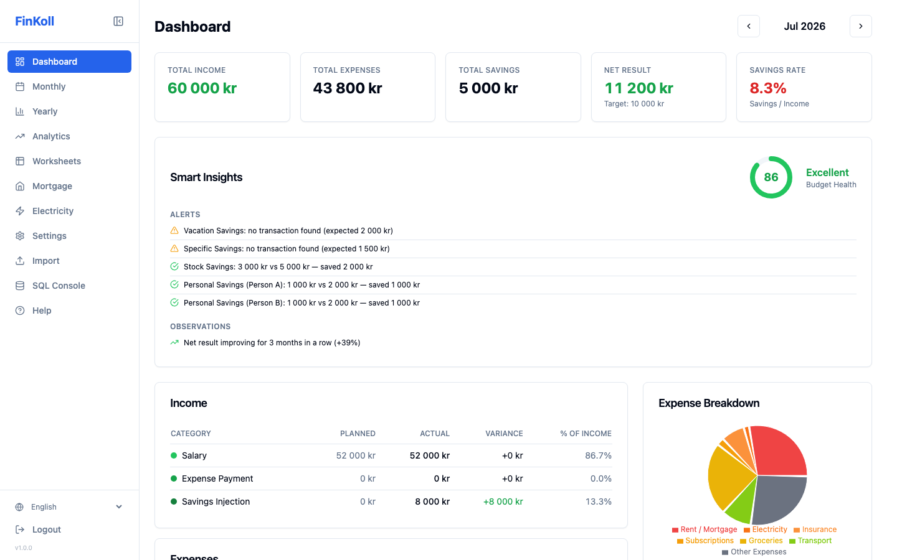
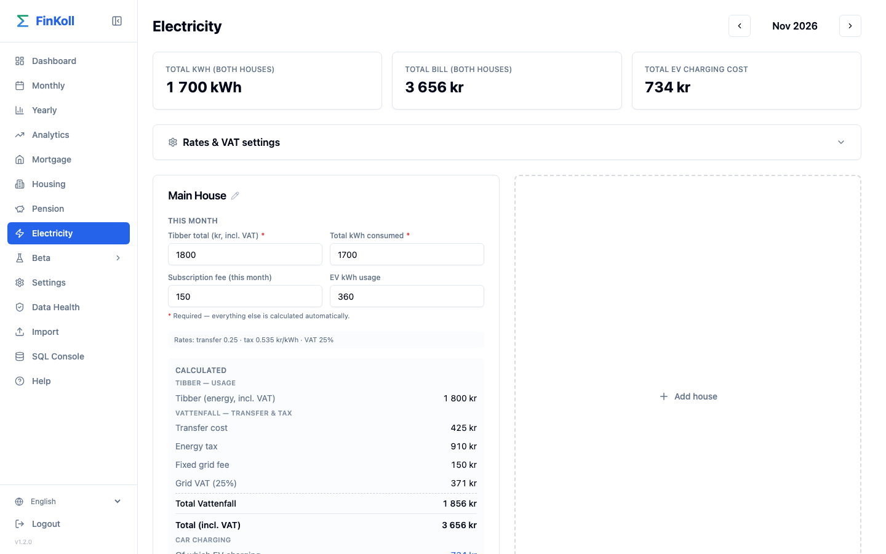
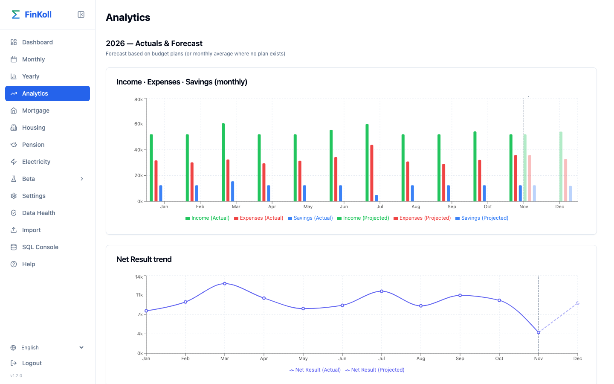
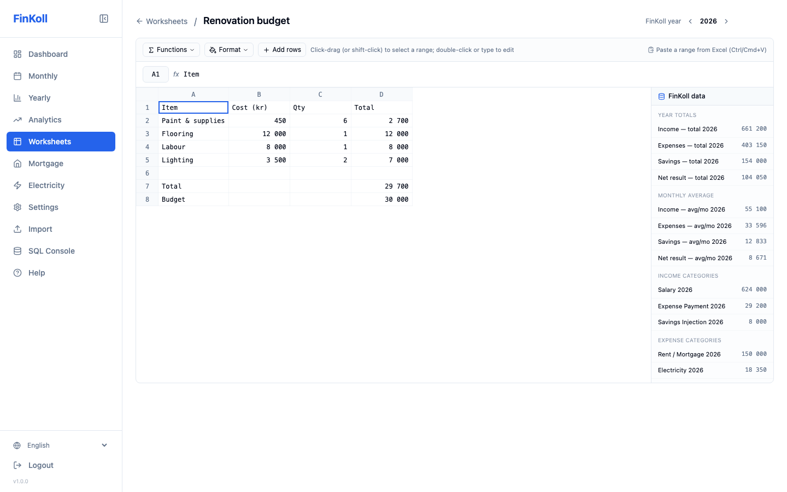

# FinKoll

A local-first household budget web application with AES-256 encrypted storage, electricity cost tracking, recurring templates, multilingual UI, and built-in backup & recovery.

> 🚀 **New here?** Start with the **[Getting Started guide](GETTING-STARTED.md)** — a
> 10-minute, step-by-step walkthrough from download to first login, including how
> to create your password.
> Also available in [Svenska](GETTING-STARTED.sv.md) and [Español](GETTING-STARTED.es.md).

---

## Table of Contents

- [Getting Started](GETTING-STARTED.md)
- [Updating (keep your data)](UPDATING.md)
- [Screenshots](#screenshots)
- [Features](#features)
- [Tech Stack](#tech-stack)
- [Requirements](#requirements)
- [First-Time Setup](#first-time-setup)
- [Running in Development](#running-in-development)
- [Updating the Application](#updating-the-application)
- [Running with Docker (Production)](#running-with-docker-production)
- [Security](#security)
- [Application Overview](#application-overview)
- [Electricity Module](#electricity-module)
- [Backup & Recovery](#backup--recovery)
- [Project Structure](#project-structure)
- [Languages](#languages)
- [License](#license)
- [Default Categories](#default-categories)

---

## Screenshots

A few highlights — see the **[full visual runthrough](docs/runthrough.md)** for
every screen ([Svenska](docs/runthrough.sv.md) · [Español](docs/runthrough.es.md)).
(Demo data; all figures fictional.)

| Dashboard | Electricity |
|---|---|
| [](docs/screenshots/dashboard.png) | [](docs/screenshots/electricity.png) |

| Analytics | Worksheets |
|---|---|
| [](docs/screenshots/analytics.png) | [](docs/screenshots/worksheet-editor.png) |

---

## Features

- **Monthly & Yearly budgeting** — plan amounts per category, then track actuals vs budget with variance columns
- **Net Result** — Income − Expenses − Savings, shown prominently in red/green everywhere
- **Savings rate %** — automatically computed from your income and savings
- **Recurring templates** — define salary, bills, and regular savings once; apply to any month in one click; supports Monthly, Quarterly, Every-6-months, and Yearly frequencies
- **Inline transaction editing** — edit date, amount, description, category, and notes for any actual directly in the monthly view
- **Duplicate detection** — transactions with the same amount and description are automatically flagged with an amber warning icon so accidental double-entries (e.g. manual + recurring) are immediately visible
- **Multilingual UI** — English (default), Swedish, and Spanish; switch from the sidebar or Settings → Language
- **Electricity cost module** — per-house kWh, grid fees, energy tax, EV charging breakdown (Vattenfall + Tibber)
- **Analytics** — savings rate trend, category spending over time, year-over-year comparison
- **Inline transaction comments** — annotate any transaction directly in the monthly view
- **Automatic daily/weekly backups** — kept for 7 days, manageable from Settings
- **Change password** from inside the app
- **AES-256 encryption at rest** — the entire SQLite database file is encrypted
- **JWT authentication** — httpOnly, SameSite=Strict cookies; no tokens ever exposed to JavaScript
- **CSV export** per year

---

## Tech Stack

| Layer | Technology |
|---|---|
| Frontend | React 18 + Vite + TypeScript |
| UI | Tailwind CSS + shadcn/ui-style components |
| Charts | Recharts |
| Data fetching | TanStack Query (React Query) |
| Backend | Node.js + Express + TypeScript |
| Database | SQLite via `better-sqlite3-multiple-ciphers` (AES-256) |
| Migrations | Drizzle ORM + drizzle-kit |
| Auth | bcrypt (cost 12) + JWT in httpOnly cookies |
| Scheduled jobs | node-cron |
| Container | Docker + Docker Compose |

---

## Requirements

### Development (local, no Docker)

- **Node.js** 20 or later — [nodejs.org](https://nodejs.org)
- **npm** 9 or later (ships with Node 20)
- **Git**

```bash
node --version   # must be >= 20
npm --version    # must be >= 9
```

### Production (Docker)

- **Docker** — [docs.docker.com/get-docker](https://docs.docker.com/get-docker/)
- **Docker Compose** v2 — included in Docker Desktop for Mac

---

## First-Time Setup

New here? The [Getting Started guide](GETTING-STARTED.md) walks through this in a
few minutes (also in [Svenska](GETTING-STARTED.sv.md) /
[Español](GETTING-STARTED.es.md)).

### 1. Clone the repository

```bash
git clone https://github.com/rohid/FinKoll.git
cd FinKoll
```

### 2. Configure — Option A: setup script (recommended)

The interactive script generates the secrets, asks for a username and password,
hashes the password, and writes your `.env` to the right place (root `.env` for
Docker, `backend/.env` for Node dev). It can start the app for you at the end.

```bash
bash scripts/setup.sh                                  # macOS / Linux
powershell -ExecutionPolicy Bypass -File scripts\setup.ps1   # Windows
```

Then jump to [Running in Development](#running-in-development) or
[Running with Docker](#running-with-docker-production).

### 2. Configure — Option B: manual

Prefer to do it by hand? Copy the example to `backend/.env` (Node dev) or `.env`
(Docker) and fill in every value:

```bash
cp .env.example backend/.env
```

```dotenv
# Long random string — used to sign JWT tokens
JWT_SECRET=change-me-to-a-long-random-string

# Exactly 32 characters — used to encrypt the SQLite database
DB_ENCRYPTION_KEY=change-me-to-a-32-char-key!!!!!!!

# Your login username
ADMIN_USERNAME=admin

# bcrypt hash of your password (cost factor 12)
# Generate it with:
#   node -e "const b=require('bcryptjs'); b.hash('yourpassword',12).then(console.log)"
ADMIN_PASSWORD_HASH=
```

**Generating a password hash** — run this once, paste the output into `ADMIN_PASSWORD_HASH`:

```bash
cd backend
npm install          # if not done yet
node -e "const b=require('bcryptjs'); b.hash('yourpassword',12).then(console.log)"
```

> **Important:** `DB_ENCRYPTION_KEY` must be **exactly 32 characters**. The app will refuse to start if it is missing.
> For Docker, double every `$` in the bcrypt hash (`$` → `$$`) — the setup script handles this for you.

### 3. Install dependencies

```bash
make install
# or manually:
npm install --prefix backend
npm install --prefix frontend
```

---

## Running in Development

```bash
make start
# or:
./scripts/start.sh
```

This starts both services and keeps them running:

| Service | URL |
|---|---|
| Frontend | http://localhost:5173 |
| Backend API | http://localhost:3001 |

Press **Ctrl-C** to stop both.

On first start the backend will:
1. Run any pending database migrations automatically
2. Seed the database with default categories and houses (only if empty)
3. Store your `ADMIN_PASSWORD_HASH` into the encrypted database

---

## Updating the Application

Pull the latest changes, reinstall dependencies, and restart:

```bash
make update
# or:
./scripts/update.sh --restart   # pull + install + start
./scripts/update.sh             # pull + install only (restart manually)
```

The update script runs `git pull --rebase`, then `npm install` for both backend and frontend, and reports the new version numbers before restarting.

---

## Running with Docker (Production)

### 1. Create a root-level `.env` file

Docker Compose reads variables from a `.env` file in the project root:

```bash
cp .env.example .env   # note: root level, not backend/
```

Fill in the same four variables as described in First-Time Setup.

### 2. Start the stack

```bash
make docker-up
# or:
docker compose up -d --build
```

| Service | Host port |
|---|---|
| Frontend (nginx) | http://localhost:5173 |
| Backend API | http://localhost:3001 |

The `data/` directory is volume-mounted so the encrypted database and backups survive container rebuilds.

### Other Docker commands

```bash
make docker-logs    # tail logs from both containers
make docker-down    # stop the stack
```

---

## Security

### Authentication

- Login with username + password before accessing any route
- Passwords hashed with **bcrypt** at cost factor 12
- Sessions are signed **JWT tokens** stored in an `httpOnly`, `SameSite=Strict` cookie — never readable by JavaScript
- All API routes require a valid JWT; unauthenticated requests return HTTP 401
- Token lifetime: **8 hours**; re-login required after expiry
- Password can be changed from **Settings → Change Password** inside the app

### Encryption at rest

- The entire SQLite file is encrypted with **AES-256** via `better-sqlite3-multiple-ciphers`
- The key comes from `DB_ENCRYPTION_KEY` in your `.env` file
- The app **exits on startup** if the key is missing or incorrect — no silent plaintext fallback
- The `data/` directory and `.env` files are in `.gitignore` and `.dockerignore`

### What to keep secret

| File | Contains |
|---|---|
| `backend/.env` | JWT secret, DB encryption key, admin credentials |
| `data/finkoll.db` | Encrypted database (safe to back up, useless without the key) |

---

## Application Overview

### Monthly view

- Month/year selector
- KPI cards: **Total Income · Total Expenses · Total Savings · Net Result · Savings Rate %**
- Budget vs Actual table per category (planned / actual / variance / % of income)
- Full transaction list with:
  - **✏️ Edit** — click the pencil icon to expand an inline form; edit date, amount, description, category, and notes, then save or cancel
  - **💬 Comment** — click the speech bubble icon to add/edit a free-text note on any transaction
  - **🗑️ Delete** — remove a transaction with one click
  - **⚠️ Duplicate warning** — any two transactions sharing the same amount and description get an amber highlight and triangle icon; hover for the full explanation
- "Apply recurring templates" button to stamp all active recurring entries for the month

### Yearly overview

- Year selector
- Matrix: rows = categories, columns = Jan–Dec + Total
- Separate sections for Income / Expenses / Savings
- Footer rows: **Total Income | Total Expenses | Total Savings | Net Result** per month
- Net Result row highlighted green (positive) or red (negative)

### Analytics

- Savings rate trend line chart (monthly)
- Category spending stacked bar chart (monthly, 1–3 years)
- Year-over-year comparison grouped bar chart

### Settings

- **Language** — switch between English, Swedish (Svenska), and Spanish (Español); persisted across sessions
- **Category management** — name, type (Income / Expense / Savings), color
- **Recurring template management** — add templates with Monthly, Quarterly, Every-6-months, or Yearly frequency; toggle active/inactive
- **Change password**
- **Backup & Recovery** — see below
- **CSV export** per year

---

## Multilingual Support

The entire UI is available in three languages:

| Language | Code | Switch via |
|---|---|---|
| English | `en` | Default |
| Svenska | `sv` | Sidebar globe icon or Settings → Language |
| Español | `es` | Sidebar globe icon or Settings → Language |

The selected language is stored in `localStorage` under `finkoll-lang` and restored on the next login. All month names, number labels, and error messages follow the active language.

To add a new language, copy `frontend/src/i18n/locales/en.json`, translate every value, save it as e.g. `de.json`, then add the entry to `LANGUAGES` in `frontend/src/i18n/index.ts`.

---

## Recurring Templates

Templates define a transaction that repeats on a schedule. Go to **Settings → Recurring Templates** to create one, then use the **Apply Recurring** button in the Monthly view to generate that month's transactions from all active templates.

### Frequencies

| Frequency | Fires when |
|---|---|
| Monthly | Every month (starting from the anchor month) |
| Quarterly | Every 3 months from the anchor (e.g. anchored in Feb → Feb, May, Aug, Nov) |
| Every 6 months | Every 6 months from the anchor (e.g. anchored in Jan → Jan, Jul) |
| Yearly | Once a year, in the same month as the anchor |

The anchor is the **Active from** month you set when creating the template. The firing rule is based on total months elapsed since the anchor, so it works correctly across year boundaries.

### Duplicate protection

If you apply recurring templates after manually entering the same transaction, the monthly view will flag both entries with an amber ⚠️ indicator. Delete the duplicate before it distorts your totals.

---

## Electricity Module

A dedicated monthly calculation view for two properties and electric car charging.

**Per house, per month inputs:**

| Field | Description |
|---|---|
| Grid subscription fee (kr) | Fixed monthly connection fee |
| Transfer rate (kr/kWh) | Grid transfer cost per kWh |
| Total kWh consumed | Meter delta for the month |
| Energy tax rate (kr/kWh) | Swedish energiskatt per kWh |
| EV kWh usage | kWh charged at this property |
| EV cost — Vattenfall (kr) | Car charging via Vattenfall |
| EV cost — Tibber (kr) | Car charging via Tibber |
| EV VAT (kr) | VAT on total EV charging |

**Calculated outputs (per house):**

```
Transfer cost     = Total kWh × Transfer rate per kWh
Energy tax        = Total kWh × Energy tax rate
Vattenfall total  = Subscription + Transfer cost + Energy tax + EV (Vattenfall)
EV total          = EV Vattenfall + EV Tibber + EV VAT
Total house bill  = Vattenfall total + EV Tibber + EV VAT
```

**Combined totals (both houses):**

```
Total kWh              = House 1 kWh + House 2 kWh
Total electricity bill = House 1 bill + House 2 bill
Total EV charging cost = House 1 EV total + House 2 EV total
```

---

## Backup & Recovery

### Automatic backups

- **Pre-update snapshot** — on **every container start** (every `docker compose up`), the database is copied to a `finkoll-preupdate-*.db` file *before* any migration runs. Startup is aborted if this snapshot fails, so an update can never proceed without a safety backup. Up to **20** of these are kept.
- **Daily** — every day at **02:00** via `node-cron`. Sundays are labeled **weekly**, other days **daily**. Up to **7** of each are kept.
- Retention is **per label group**, so routine daily backups can never evict the pre-update or manual safety snapshots.
- Backup files are stored in `data/backups/` and survive container restarts.

> **Recovering lost data:** if data goes missing, check `data/backups/` for a `preupdate` or `daily` snapshot taken before the loss. Restore it from **Settings → Backup & Recovery**, or inspect it with the **SQL Console** (see below).

### Manual backups

Go to **Settings → Backup & Recovery** and click **Backup Now**.

### Restoring a backup

In **Settings → Backup & Recovery**, find the backup you want and click **Restore**.

- A confirmation dialog warns you that current data will be replaced
- The server closes the database, copies the backup over the live file, and exits — Docker or nodemon restarts it automatically with the restored data

### Downloading a backup

Click **Download** next to any backup entry to save the raw (encrypted) `.db` file to your computer. This is useful for off-site storage — the file is encrypted and useless without `DB_ENCRYPTION_KEY`.

### Backup file naming

```
finkoll-<label>-<YYYY-MM-DD_HH-MM-SS>.db
```

Labels: `preupdate` · `daily` · `weekly` · `manual` · `presql`
Example: `finkoll-preupdate-2026-06-02_09-14-22.db`

---

## SQL Console

A built-in database query interface at **SQL Console** in the sidebar — useful for inspecting data, ad-hoc reporting, and recovering records.

- **Read queries** (`SELECT`, `PRAGMA`, `EXPLAIN`, `WITH`) run freely and render as a table.
- **Write queries** (`INSERT`, `UPDATE`, `DELETE`, DDL) require ticking the **Enable writes** toggle, and the server **automatically creates a backup** (`presql` label) before executing — so a mistaken write is always recoverable.
- A **Schema** panel lists every table and its columns; click a table name to generate a `SELECT * ... LIMIT 50`.
- Sample queries are provided. Press **⌘/Ctrl + Enter** to run.

The console runs against the live encrypted database through the authenticated API — no separate database tooling or decryption key handling needed.

---

## Month Locking

Finalised months can be locked to prevent accidental changes. In the **Monthly** view, click **🔒 Lock month**. While locked:

- The add / edit / delete / comment controls are hidden in the UI, **and**
- The **server rejects** any create, edit, delete, clear-month, or apply-recurring request for that month (HTTP 423) — so the lock is real protection, not just a hidden button.

Click **🔓 Unlock month** to make changes again. Locked months show a small 🔒 in the Yearly overview.

---

## Project Structure

```
FinKoll/
├── Makefile                  # make start | update | docker-up | …
├── docker-compose.yml        # production stack
├── .env.example              # template for secrets (copy to backend/.env)
├── scripts/
│   ├── start.sh              # start backend + frontend (dev)
│   └── update.sh             # git pull + npm install [+ restart]
├── data/                     # gitignored — created at runtime
│   ├── finkoll.db            # encrypted SQLite database
│   └── backups/              # automatic + manual backup files
├── backend/
│   ├── src/
│   │   ├── db/
│   │   │   ├── schema.ts     # Drizzle table definitions
│   │   │   ├── migrations/   # auto-generated SQL migrations
│   │   │   ├── index.ts      # opens & encrypts the DB connection
│   │   │   └── seed.ts       # default categories + houses
│   │   ├── routes/           # one file per resource group
│   │   │   ├── auth.ts       # login / logout / change-password
│   │   │   ├── categories.ts
│   │   │   ├── transactions.ts
│   │   │   ├── budget.ts
│   │   │   ├── recurring.ts
│   │   │   ├── summary.ts
│   │   │   ├── electricity.ts
│   │   │   └── backup.ts
│   │   ├── services/
│   │   │   ├── summary.ts    # budget-vs-actual calculations
│   │   │   └── backup.ts     # create / list / restore / prune
│   │   ├── middleware/
│   │   │   └── auth.ts       # JWT validation middleware
│   │   └── index.ts          # Express app + cron scheduler
│   ├── .env                  # your secrets (gitignored)
│   ├── Dockerfile
│   └── package.json
└── frontend/
    ├── src/
    │   ├── api/
    │   │   ├── client.ts     # axios instance (base URL + credentials)
    │   │   └── hooks.ts      # all TanStack Query hooks
    │   ├── components/
    │   │   ├── ui/           # Button, Card, Input, Badge, …
    │   │   ├── charts/       # Recharts wrappers
    │   │   └── layout/       # Sidebar, AppLayout
    │   ├── i18n/
    │   │   ├── index.ts      # i18next init + LANGUAGES export
    │   │   └── locales/
    │   │       ├── en.json   # English (default)
    │   │       ├── sv.json   # Swedish
    │   │       └── es.json   # Spanish
    │   ├── pages/
    │   │   ├── Dashboard.tsx
    │   │   ├── Monthly.tsx
    │   │   ├── Yearly.tsx
    │   │   ├── Analytics.tsx
    │   │   ├── Electricity.tsx
    │   │   ├── Settings.tsx
    │   │   └── Login.tsx
    │   ├── types/            # shared TypeScript interfaces
    │   └── globals.d.ts      # __APP_VERSION__ type declaration
    ├── nginx.conf            # production nginx config (SPA + API proxy)
    ├── vite.config.ts        # Vite + dev proxy + version injection
    ├── Dockerfile
    └── package.json
```

---

## Default Categories

The database is seeded with these categories on first run:

| Name | Type | Subtype |
|---|---|---|
| Salary | Income | SALARY |
| Expense Payment | Income | EXPENSE_PAYMENT |
| Savings Injection | Income | SAVINGS_INJECTION |
| Bills | Expense | BILL |
| Stock | Savings | STOCK |
| Vacation | Savings | VACATION |
| Specific Savings | Savings | SPECIFIC |
| Personal — Person A | Savings | PERSONAL_A |
| Personal — Person B | Savings | PERSONAL_B |

Categories can be renamed, recolored, and extended in **Settings → Categories**.

---

## Makefile Reference

```
make start        Start backend + frontend in development mode
make update       Pull latest, reinstall deps, restart
make install      Install all npm dependencies (no start)
make build        Compile the backend TypeScript
make docker-up    Build and start the production Docker stack
make docker-down  Stop the Docker stack
make docker-logs  Tail Docker Compose logs
```

---

## Languages

FinKoll ships with a fully translated interface in **English**, **Svenska**
(Swedish), and **Español** (Spanish). On first load the app picks the language
that matches your browser's preferred locale and falls back to English for any
other locale. You can change it at any time from the language selector in the
sidebar (or the mobile menu); your choice is remembered on that device.

To add another language, copy `frontend/src/i18n/locales/en.json` to
`<code>.json`, translate the values, and register it in
`frontend/src/i18n/index.ts`.

---

## License

Released under the [MIT License](LICENSE). You are free to use, modify, and
distribute it. The bundled spreadsheet engine ([HyperFormula](https://hyperformula.handsontable.com/))
is used under its free open-source tier, which is compatible with this project's
open-source distribution.
