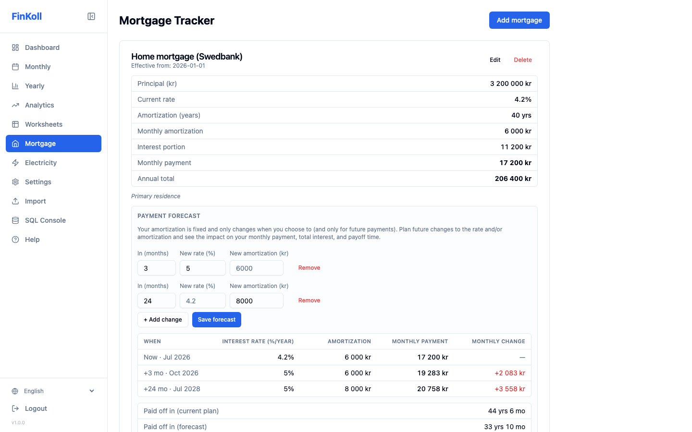
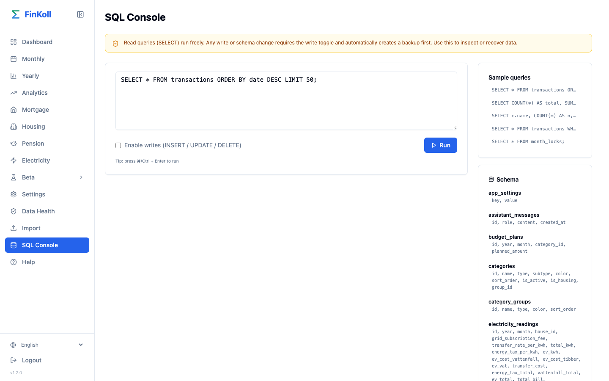

# FinKoll — Recorrido visual

🌐 [English](runthrough.md) · [Svenska](runthrough.sv.md) · **Español**

Un recorrido guiado por todas las pantallas de FinKoll, capturado desde una
instancia de demostración con un año completo de datos domésticos realistas.
Todas las cifras son ficticias.

> *Las capturas están en inglés por ahora.*

> ¿Quieres probarlo? Consulta la [guía de primeros pasos](../GETTING-STARTED.es.md)
> ([English](../GETTING-STARTED.md) · [Svenska](../GETTING-STARTED.sv.md)).

---

## Panel (Dashboard)

Tu mes de un vistazo: ingresos, gastos, ahorros, **resultado neto** y tasa de
ahorro arriba, un panel de **Smart Insights** (puntuación de salud, alertas de
presupuesto y observaciones de tendencia), tablas de presupuesto vs. real y un
desglose de gastos.

---

## Mensual

La vista de trabajo para un solo mes — planeado vs. real por categoría con
varianza, edición en línea, aplicación de plantillas recurrentes y detección de
duplicados.

---

## Anual

Todo el año en una matriz: cada etiqueta de transacción agrupada bajo su
categoría, los meses en la parte superior, con el mes actual resaltado y los
resultados marcados según tus objetivos.

---

## Analíticas

Datos reales más una previsión para el resto del año, una tendencia del resultado
neto, un desglose de ahorros y una sección dedicada a la **electricidad** (coste
por fuente y consumo mensual).

---

## Electricidad

Un seguimiento de electricidad centrado en Tibber y con cálculo automático — por
casa y por mes. Introduce el total de Tibber y los kWh; FinKoll calcula la parte
de red de Vattenfall (transferencia, impuesto energético, cuota fija, IVA) y la
parte de carga del coche eléctrico. Admite varias casas con tarifas compartidas o
por casa.

---

## Hojas de cálculo (Worksheets)

Hojas de cálculo personalizadas con fórmulas reales (con tecnología de
HyperFormula) para cálculos puntuales — reformas, viajes, escenarios de hipoteca.
Un panel de **datos de FinKoll** expone tus totales de presupuesto en vivo como
valores con nombre que puedes referenciar.

---

## Hipoteca

Controla hipotecas con una **amortización mensual fija** más el interés (total =
interés + amortización). La **previsión de pagos** te permite planificar futuros
cambios del tipo y/o la amortización ("dentro de 3 meses el tipo sube al 5 %"), ver
el impacto en tu cuota mensual, el interés total y el tiempo de liquidación — y
**guardarla** para tenerla la próxima vez. Ideal para planificar o negociar con el
banco.

---

## Importar

Trae transacciones desde una hoja de cálculo, con mapeo de categorías que FinKoll
recuerda para la próxima vez.

---

## Consola SQL

Una consola SQL para usuarios avanzados que quieran consultar directamente su
propia base de datos cifrada.

---

## Ajustes

Categorías (renombrar, recolorear, reordenar), el objetivo de resultado neto,
copias de seguridad, idioma, apariencia y cambio de contraseña — todo en un solo
lugar.

---

## Ayuda

Una sección de ayuda integrada e ilustrada con una guía rápida para el flujo de
plantillas de presupuesto/mensual, disponible en inglés, sueco y español.

