# FinKoll — Recorrido visual

🌐 [English](runthrough.md) · [Svenska](runthrough.sv.md) · **Español**

Un recorrido guiado por todas las pantallas de FinKoll, capturado desde una
instancia de demostración con un año completo de datos domésticos realistas.
Todas las cifras son ficticias.

> *Las capturas están en inglés por ahora.*

> ¿Quieres probarlo? Consulta la [guía de primeros pasos](../GETTING-STARTED.es.md)
> ([English](../GETTING-STARTED.md) · [Svenska](../GETTING-STARTED.sv.md)).

---

## Panel (Dashboard)

Tu mes de un vistazo: ingresos, gastos, ahorros, **resultado neto** y tasa de
ahorro arriba, un panel de **Smart Insights** (puntuación de salud, alertas de
presupuesto y observaciones de tendencia), tablas de presupuesto vs. real y un
desglose de gastos.

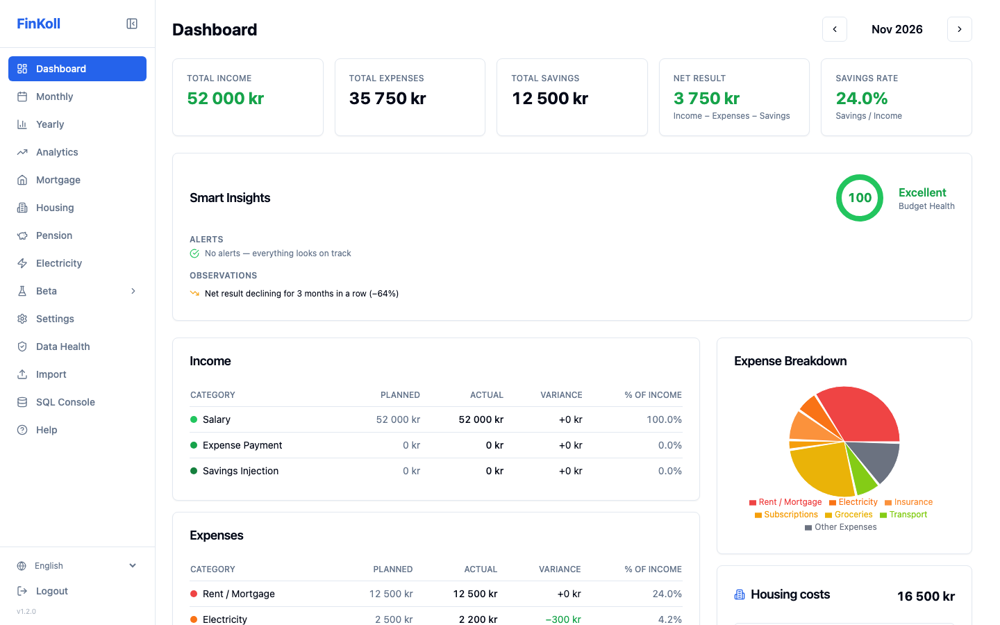

---

## Asistente

Un chat para **consultar y añadir datos** en lenguaje natural — un copiloto financiero
que conoce tus cifras. Haz preguntas abiertas ("¿cuál es nuestro patrimonio neto?",
"¿consumo eléctrico medio mensual?", "¿cuánto gastamos en comida al mes?") o añade
entradas ("añade la hipoteca de la casa principal de este mes, 2 500 kr"). El modelo
solo **enruta**: cada cifra la calcula FinKoll (nunca la inventa), lo que las
herramientas integradas no cubren se ejecuta como **SQL de solo lectura** sobre tu
propia base de datos, y cada cambio es un **borrador que confirmas** antes de guardarlo
— no se escribe nada por ti. El **motor de IA es intercambiable** y está **desactivado
por defecto**: apúntalo a una clave en la nube (Claude) o a un modelo local (Ollama en
una pequeña máquina que añadas, dejando la Pi sin carga), configurado en Ajustes.

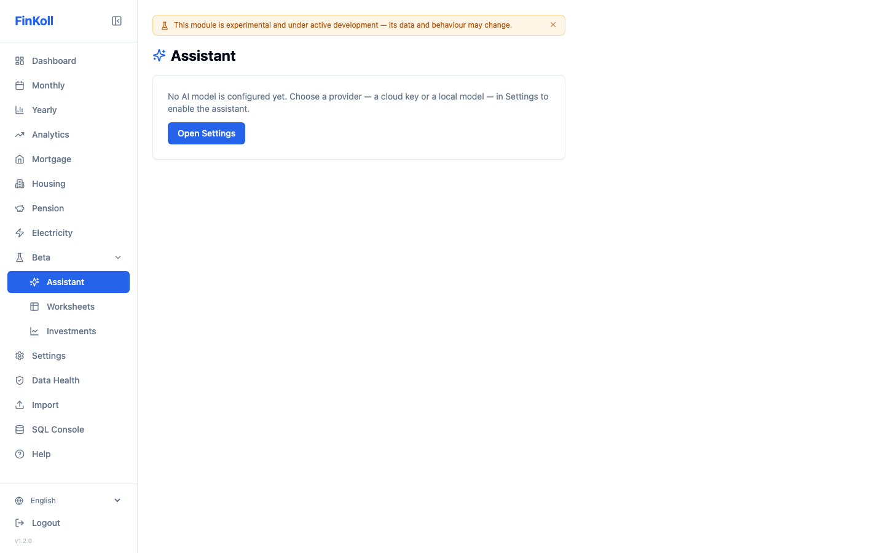

---

## Mensual

La vista de trabajo para un solo mes — planeado vs. real por categoría con
varianza, edición en línea, aplicación de plantillas recurrentes y detección de
duplicados.

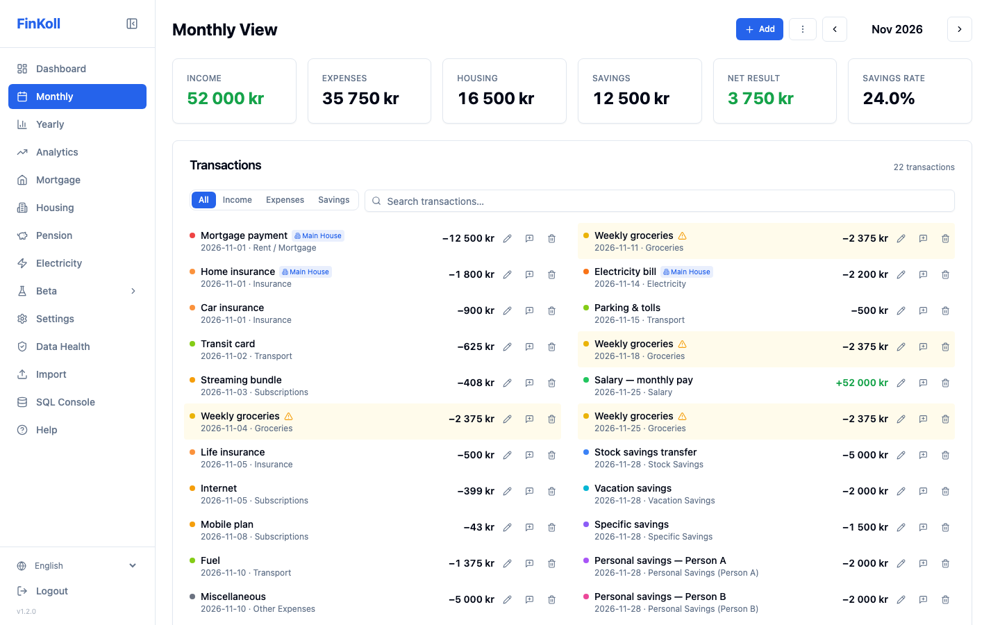

---

## Anual

Todo el año en una matriz: cada etiqueta de transacción agrupada bajo su
categoría, los meses en la parte superior, con el mes actual resaltado y los
resultados marcados según tus objetivos.

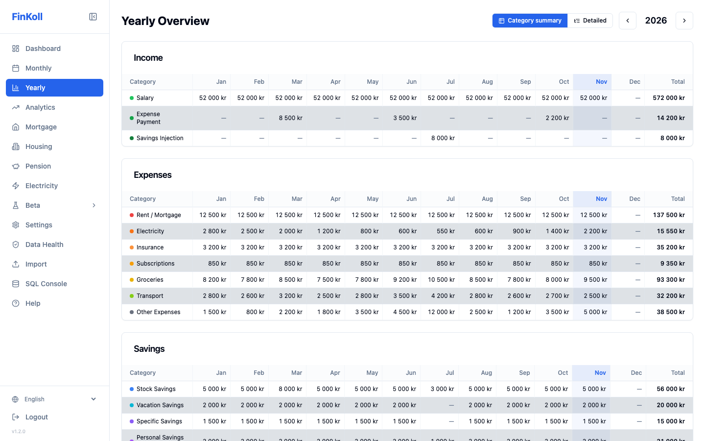

---

## Analíticas

Datos reales más una previsión para el resto del año, una tendencia del resultado
neto, un desglose de ahorros y una sección dedicada a la **electricidad** (coste
por fuente y consumo mensual).

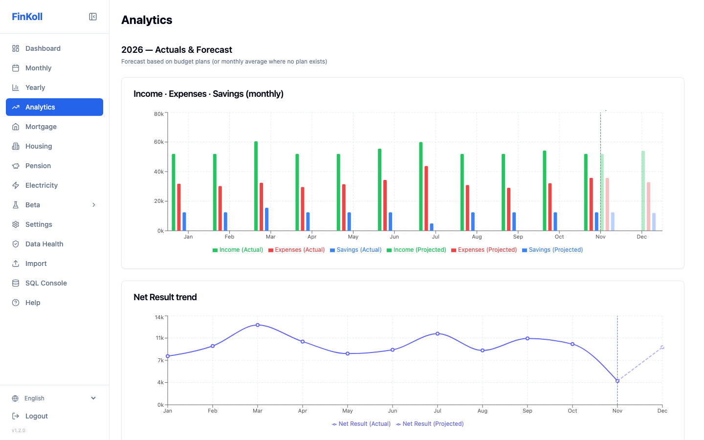

---

## Electricidad

Un seguimiento de electricidad centrado en Tibber y con cálculo automático — por
casa y por mes. Introduce el total de Tibber y los kWh; FinKoll calcula la parte
de red de Vattenfall (transferencia, impuesto energético, cuota fija, IVA) y la
parte de carga del coche eléctrico. Admite varias casas con tarifas compartidas o
por casa.

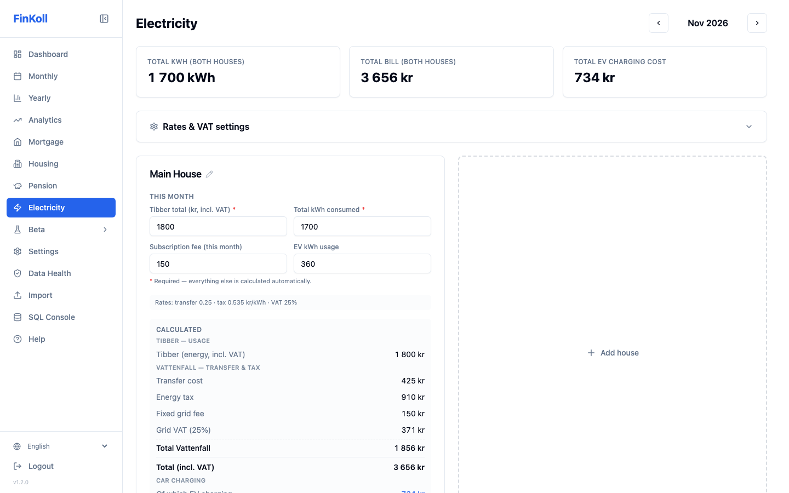

---

## Hojas de cálculo (Worksheets)

Hojas de cálculo personalizadas con fórmulas reales (con tecnología de
HyperFormula) para cálculos puntuales — reformas, viajes, escenarios de hipoteca.
Un panel de **datos de FinKoll** expone tus totales de presupuesto en vivo como
valores con nombre que puedes referenciar.

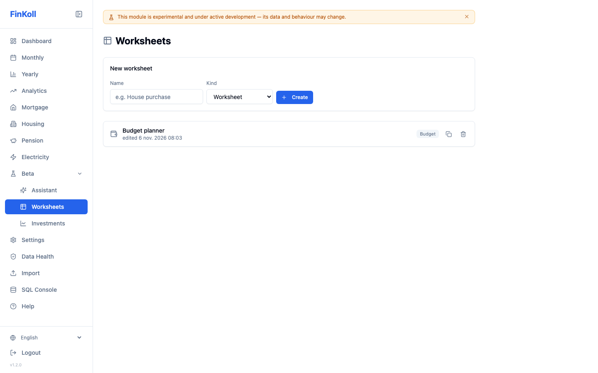

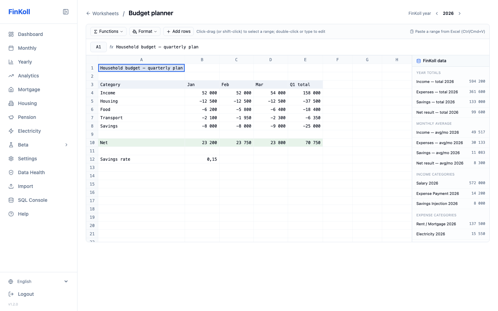

---

## Hipoteca

Controla hipotecas con una **amortización mensual fija** más el interés (total =
interés + amortización). **Agrupa préstamos por casa/objeto** — pulsa **Agrupar
préstamos**, marca los que quieras combinar, ponle nombre al grupo y confirma —
para ver la deuda total, el tipo de interés combinado (con el rango resaltado
cuando los tipos difieren) y el coste mensual total. **La previsión se hace a nivel
de grupo**: abre la **Previsión** del grupo para ver una **proyección** del coste
mensual combinado y el saldo restante a **1, 5 y 10 años** (cuánto habrás
amortizado). Planifica futuros cambios de tipo/amortización como **una previsión
para todo el grupo** (por defecto), o cambia a **por préstamo** cuando difieran —
en ambos casos se guarda. Los préstamos independientes (sin grupo) mantienen su
propia previsión en su tarjeta. Ideal para planificar o negociar con el banco.

---

## Costes de vivienda

Consulta el coste recurrente de tu **residencia principal** por separado del
resto. Cada transacción puede asignarse a una **casa/propiedad** (las mismas casas
que el módulo de Electricidad), y los costes de vivienda son las transacciones de
la **residencia principal** (elegida aquí). Mantienes una sola categoría por tipo
de coste: las categorías de vivienda (Alquiler/Hipoteca, Electricidad, Seguro)
asignan las nuevas transacciones a la casa principal por defecto, y reasignas las
de la casa de campo por transacción. Una factura que cubre ambas casas (p. ej. una
factura de electricidad) puede **dividirse**, asignando cada línea a su propia casa —
así solo cuenta la línea de la residencia principal y se excluye la de la casa de
campo, mientras la transacción sigue siendo una sola entrada. Las plantillas
recurrentes también pueden llevar una casa (principal, de campo o general), de modo
que los costes generados se asignan a la propiedad correcta automáticamente. Los
costes de vivienda aparecen en la vista
Mensual (un indicador + desglose de lo que se incluye), en la vista Anual (una
tabla de vivienda y una fila de subtotal en la matriz detallada), y en esta página
dedicada con una matriz categoría × mes.

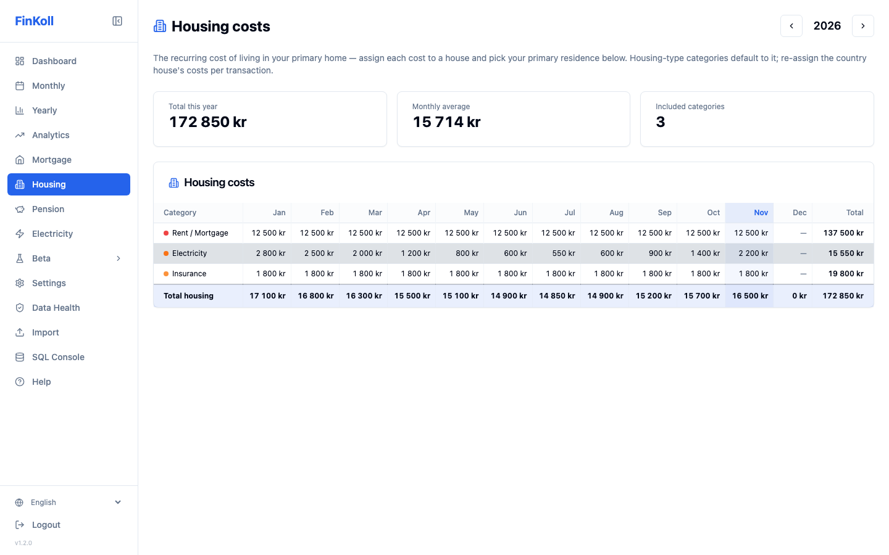

---

## Inversiones

Sigue una cartera de acciones y fondos con ganancia/pérdida casi en vivo. Añade
posiciones con **autocompletado de símbolo**; FinKoll obtiene precios y divisa y lo
convierte todo a **SEK**, mostrando la ganancia/pérdida por posición y total, el
cambio del día y un **gráfico de evolución**. Los datos de mercado provienen de un
**proveedor intercambiable** — **Yahoo Finance** gratis por defecto (diferido /
cierre), o un modo **manual** donde tú introduces los precios y no se descarga nada.
La fuente se cambia desde ajustes, así que un feed de pago/oficial (o una
importación del bróker) puede añadirse más adelante.

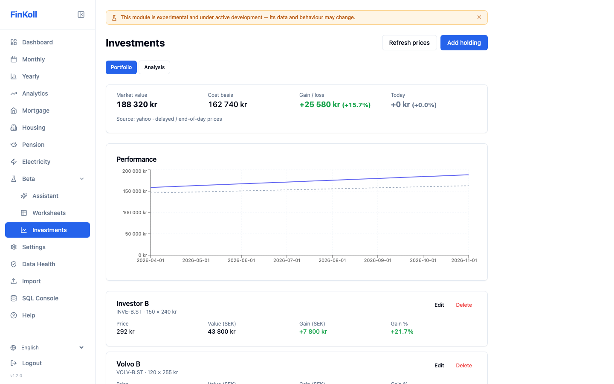

Una pestaña de **Análisis** convierte los mismos datos en tres vistas ordenables:
**Valoración** (P/E, P/B, rentabilidad por dividendo — se resaltan las filas
baratas), **Deuda** (deuda/patrimonio, capitalización) y **Rendimiento**
(rentabilidad a 1 mes, 3 meses, 1 año y ganancia total).

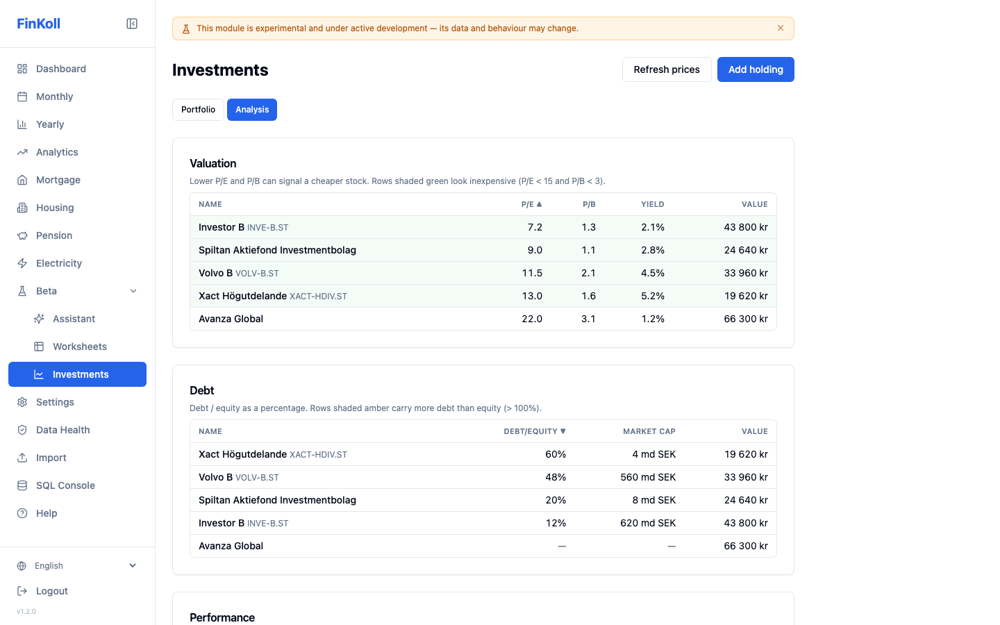

---

## Pensión

El centro del patrimonio neto. Reúne tu capital de pensión en un solo lugar —
normalmente pegado desde **minpension.se**. Las posiciones se agrupan en las tres
categorías suecas (**allmän**, **tjänstepension**, **privat**) con subtotales y total,
un **pago mensual proyectado** opcional, un gráfico de **valor a lo largo del tiempo** y
un **importador por pegado** (una posición por línea). Cada vez que actualizas un valor
se registra una instantánea, y una tabla de **variación mensual** muestra el cambio mes
a mes (kr y %) con el total actual. La página calcula el **patrimonio neto =
inversiones + capital de pensión + capital inmobiliario**: da a cada inmueble un **valor
de mercado** y **tu parte** (p. ej. 50 % de una vivienda en copropiedad) y asigna cada
hipoteca al inmueble que la garantiza, de modo que tu capital = **(valor de mercado − el
préstamo del inmueble) × tu parte**. La pensión es **capital / patrimonio**, no flujo de
caja mensual, así que queda fuera del resultado neto del presupuesto (y vive aquí en
lugar de en la vista anual). *(Próximamente: planificación de retiros.)*

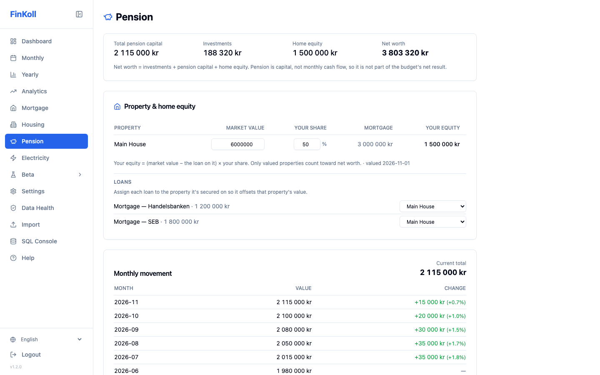

---

## Importar

Trae transacciones desde una hoja de cálculo, con mapeo de categorías que FinKoll
recuerda para la próxima vez.

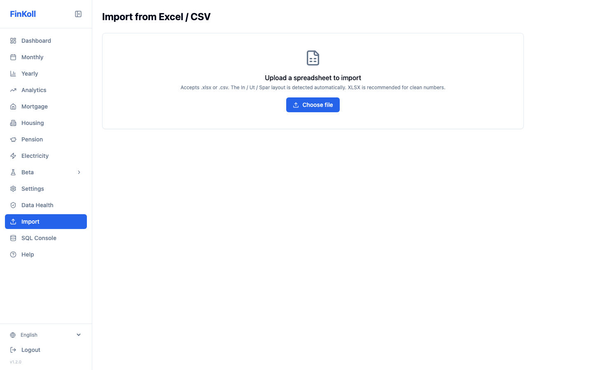

---

## Consola SQL

Una consola SQL para usuarios avanzados que quieran consultar directamente su
propia base de datos cifrada.

---

## Ajustes

Categorías (renombrar, recolorear, reordenar), el objetivo de resultado neto,
copias de seguridad, idioma, apariencia y cambio de contraseña — todo en un solo
lugar.

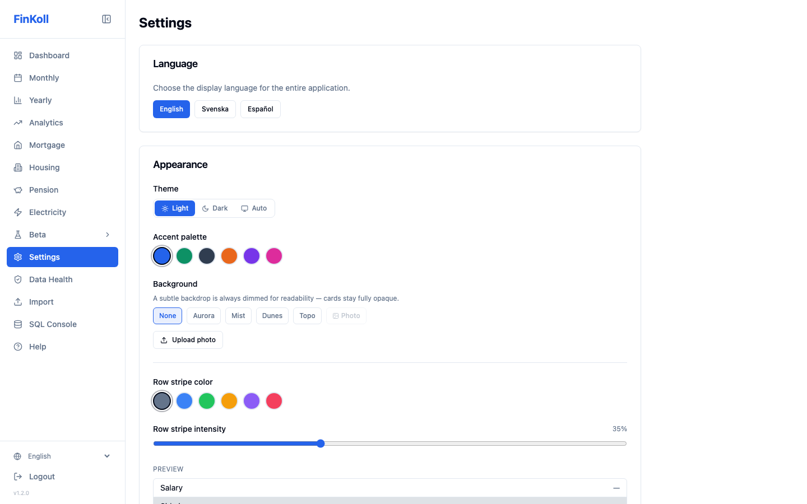

---

## Ayuda

Una sección de ayuda integrada e ilustrada con una guía rápida para el flujo de
plantillas de presupuesto/mensual, disponible en inglés, sueco y español.

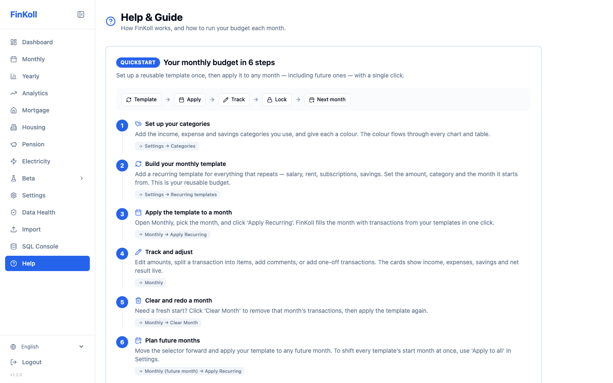
