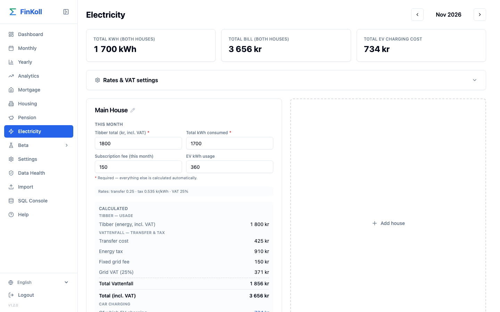

# FinKoll — Visual Runthrough

🌐 **English** · [Svenska](runthrough.sv.md) · [Español](runthrough.es.md)

A guided tour of every screen in FinKoll, captured from a demo instance seeded
with a full year of realistic household data. All figures are fictional.

> Want to try it yourself? See the [Getting Started guide](../GETTING-STARTED.md)
> ([Svenska](../GETTING-STARTED.sv.md) · [Español](../GETTING-STARTED.es.md)).

---

## Dashboard

Your month at a glance: income, expenses, savings, **net result**, and savings
rate up top, a **Smart Insights** panel (health score, budget alerts, and trend
observations), budget-vs-actual tables, and an expense breakdown.

---

## Monthly

The working view for a single month — planned vs actual per category with
variance, inline editing, recurring-template application, and duplicate
detection.

---

## Yearly

The whole year in one matrix: every transaction label grouped under its
category, months across the top, with the current month highlighted and results
flagged against your targets.

---

## Analytics

Actuals plus a forecast for the rest of the year, a net-result trend, a savings
breakdown, and a dedicated **electricity** section (cost by source and monthly
consumption).

---

## Electricity

A Tibber-centric, auto-calculating electricity tracker — per house, per month.
Enter the Tibber total and kWh; FinKoll computes the Vattenfall grid side
(transfer, energy tax, fixed fee, VAT) and the EV-charging share. Supports
multiple houses with shared or per-house rates.

---

## Worksheets

Custom spreadsheets with real formulas (powered by HyperFormula) for one-off
calculations — renovations, trips, mortgage scenarios. A **FinKoll data** side
panel exposes your live budget totals as named values you can reference.

---

## Mortgage

Track mortgages with a **fixed monthly amortization** plus interest (total =
interest + amortization). The **payment forecast** lets you plan future changes
to the rate and/or amortization ("in 3 months the rate rises to 5%"), see the
impact on your monthly payment, total interest, and payoff time — and **save it**
so it's there next time. Great for planning ahead or negotiating with the bank.

---

## Import

Bring in transactions from a spreadsheet, with category mapping that FinKoll
remembers for next time.

---

## SQL Console

A read-only-friendly SQL console for power users to query their own encrypted
database directly.

---

## Settings

Categories (rename, recolor, reorder), the net-result target, backups, language,
appearance, and changing your password — all in one place.

---

## Help

A built-in, illustrated help section with a quickstart for the budget/monthly
template workflow, available in English, Swedish, and Spanish.

