# FinKoll — Visual Runthrough

🌐 **English** · [Svenska](runthrough.sv.md) · [Español](runthrough.es.md)

A guided tour of every screen in FinKoll, captured from a demo instance seeded
with a full year of realistic household data. All figures are fictional.

> Want to try it yourself? See the [Getting Started guide](../GETTING-STARTED.md)
> ([Svenska](../GETTING-STARTED.sv.md) · [Español](../GETTING-STARTED.es.md)).

---

## Dashboard

Your month at a glance: income, expenses, savings, **net result**, and savings
rate up top, a **Smart Insights** panel (health score, budget alerts, and trend
observations), budget-vs-actual tables, and an expense breakdown.

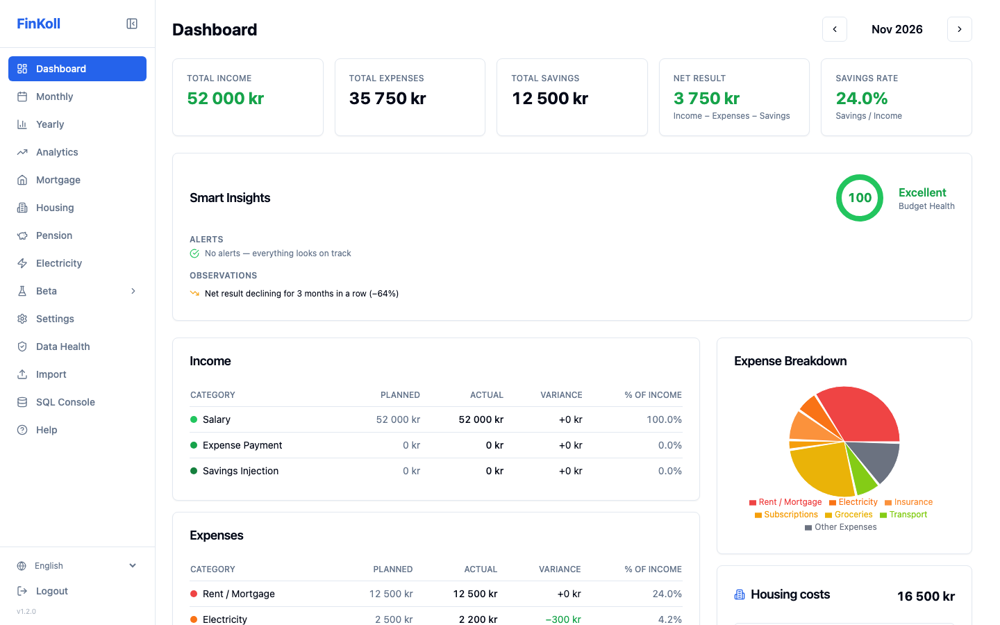

---

## Assistant

One chat to **query and add data** in plain language — a financial copilot that knows
your numbers. Ask open-ended questions ("what's our net worth?", "average monthly
electricity use?", "how much do we spend on groceries per month?") or add entries
("add this month's main-house mortgage, 2 500 kr"). The model only **routes**: every
figure is computed by FinKoll (never invented), anything the built-in tools don't cover
runs as **read-only SQL** over your own database, and every change is a **draft you
confirm** before it's saved — nothing is written on your behalf. The **AI backend is
pluggable** and **off by default**: point it at a cloud key (Claude) or a local model
(Ollama on a small box you add, leaving the Pi unloaded), set in Settings.

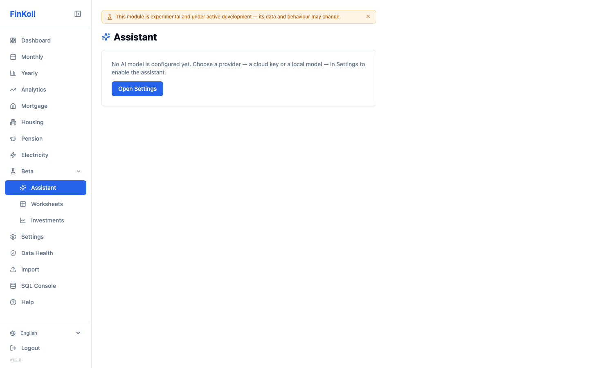

---

## Monthly

The working view for a single month — planned vs actual per category with
variance, inline editing, recurring-template application, and duplicate
detection.

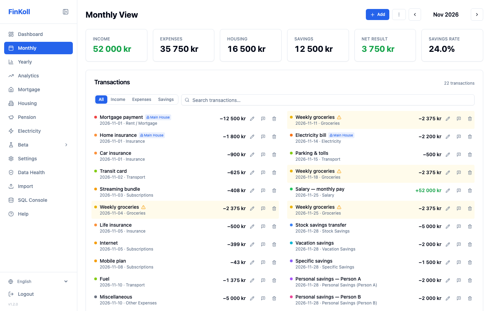

---

## Yearly

The whole year in one matrix: every transaction label grouped under its
category, months across the top, with the current month highlighted and results
flagged against your targets.

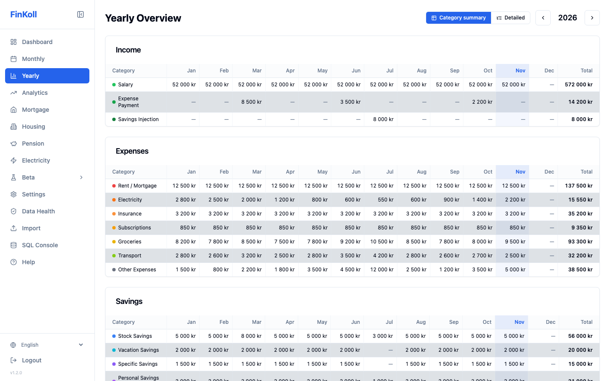

---

## Analytics

Actuals plus a forecast for the rest of the year, a net-result trend, a savings
breakdown, and a dedicated **electricity** section (cost by source and monthly
consumption).

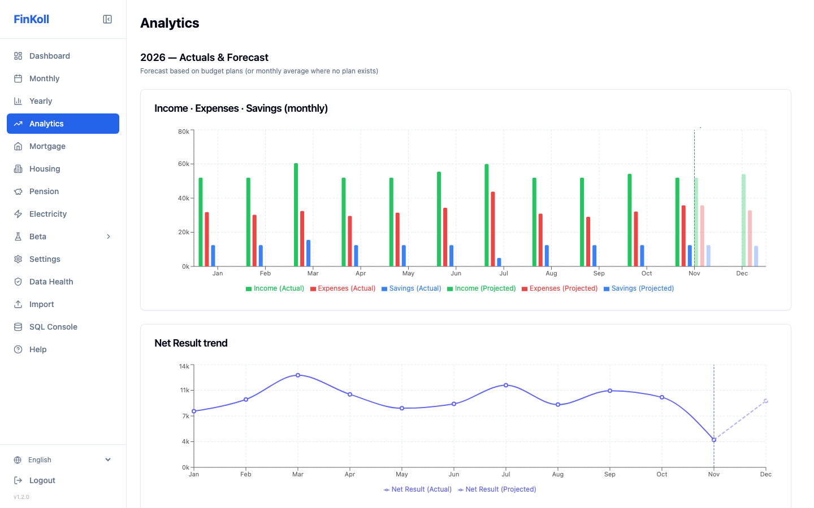

---

## Electricity

A Tibber-centric, auto-calculating electricity tracker — per house, per month.
Enter the Tibber total and kWh; FinKoll computes the Vattenfall grid side
(transfer, energy tax, fixed fee, VAT) and the EV-charging share. Supports
multiple houses with shared or per-house rates.

---

## Worksheets

Custom spreadsheets with real formulas (powered by HyperFormula) for one-off
calculations — renovations, trips, mortgage scenarios. A **FinKoll data** side
panel exposes your live budget totals as named values you can reference.

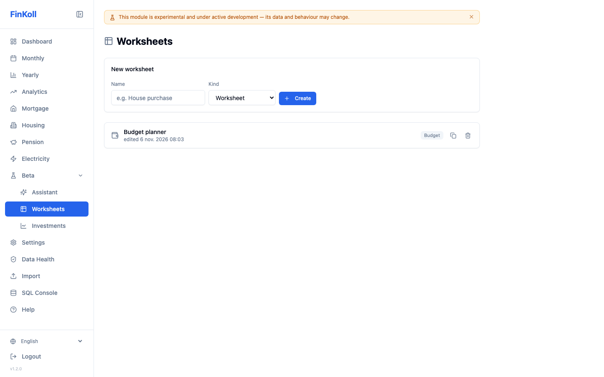

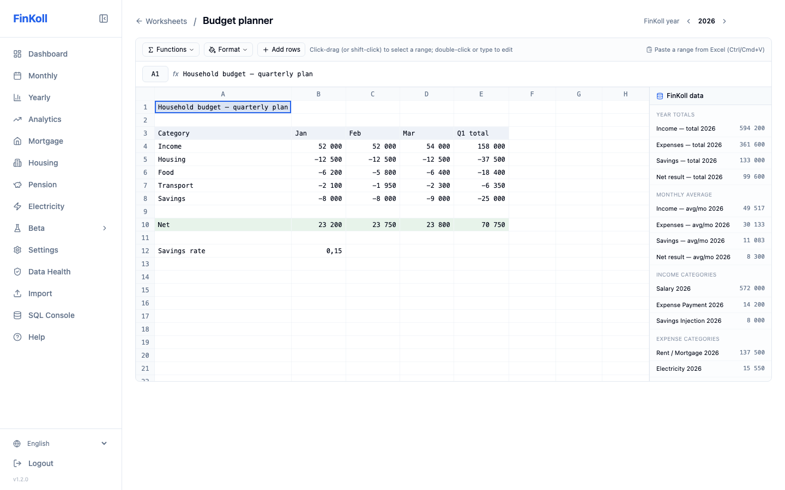

---

## Mortgage

Track mortgages with a **fixed monthly amortization** plus interest (total =
interest + amortization). **Group loans by house/object** — hit **Group loans**,
tick the ones to combine, name the group, and confirm — to see the combined
total, the blended interest rate (with the spread highlighted when rates differ),
and total monthly cost. **Forecasting is done at the group level**: open the
group's **Forecast** to see a **projection** of its combined monthly cost and
remaining balance at **1, 5, and 10 years** (how much you'll have paid down). Plan
future rate/amortization changes as **one forecast for the whole group** (the
default), or switch to **per loan** when they diverge — either way it's saved.
Standalone (ungrouped) loans keep their own forecast on their card. Great for
planning ahead or negotiating with the bank.

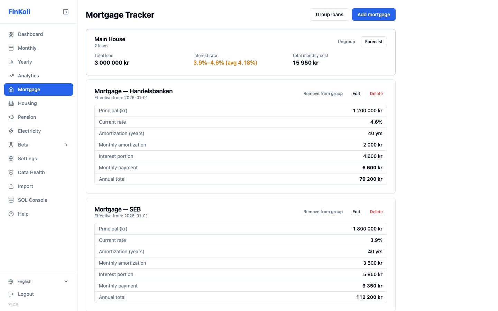

---

## Housing costs

See the recurring cost of your **primary home** on its own — separated from
everything else. Each transaction can be assigned to a **house/property** (the same
houses as the Electricity module), and housing costs are the transactions of the
**primary residence** (chosen here). You keep one shared category per cost type:
housing-type categories (Rent/Mortgage, Electricity, Insurance) default new
transactions to the primary house, and you re-assign the country house's ones
per transaction. A single bill that covers both homes (e.g. one electricity payment)
can be **split**, with each line assigned to its own house — housing then counts only
the primary-home line, and the country-home line is left out, while the transaction
stays one entry. Recurring templates can also carry a house (main, country, or
general), so generated costs land on the right property automatically. Housing costs
show up on the Monthly view (a KPI + breakdown of
what's included), in the Yearly view (a Housing table and a subtotal row in the
detailed matrix), and on this dedicated page with a category × month matrix.

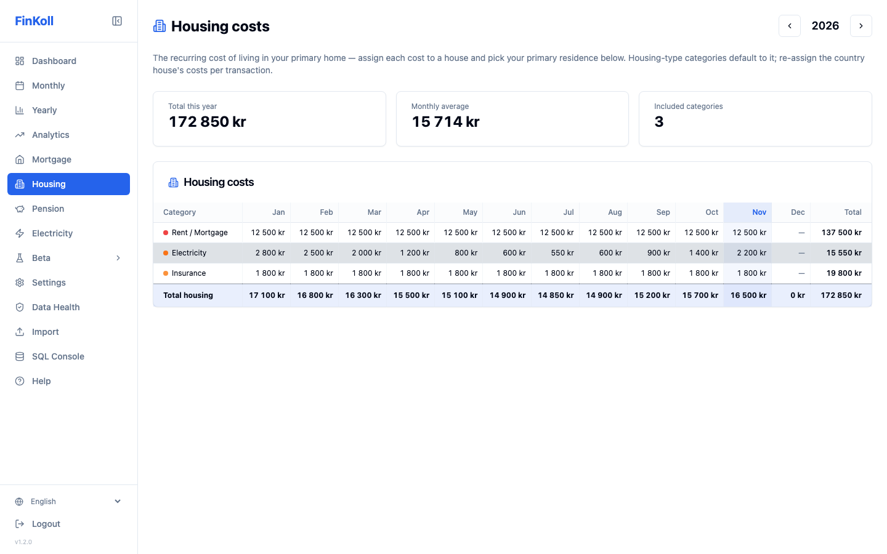

---

## Investments

Track a portfolio of stocks and funds with live-ish gain/loss. Add holdings with
**symbol autocomplete**; FinKoll pulls quotes and FX and converts everything to
**SEK**, showing per-position and total **gain/loss**, the day's change, and a
**performance-over-time** chart. Market data comes from a **pluggable provider** —
free **Yahoo Finance** by default (delayed / end-of-day), or a **manual** mode
where you enter prices yourself and nothing is fetched. The source is swappable
from settings, so a paid/official feed (or a broker import) can drop in later.

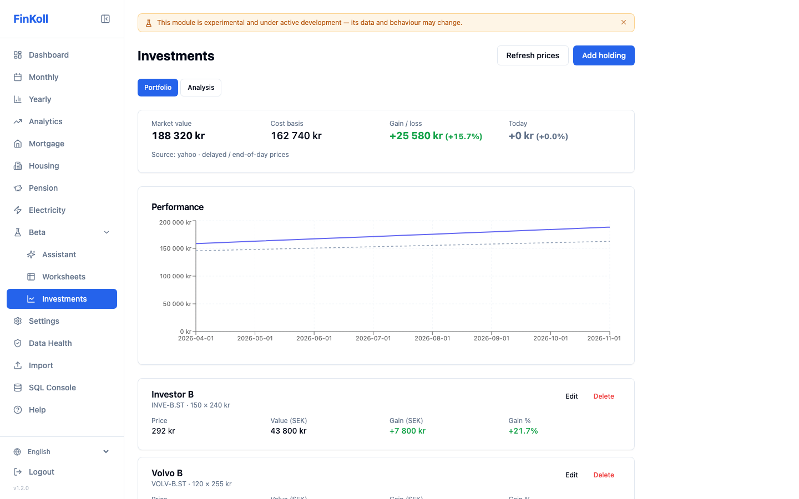

An **Analysis** tab turns the same data into three sortable views: **Valuation**
(P/E, P/B, yield — cheap-looking rows highlighted), **Debt** (debt/equity, market
cap), and **Performance** (1-month, 3-month, 1-year returns and total gain).

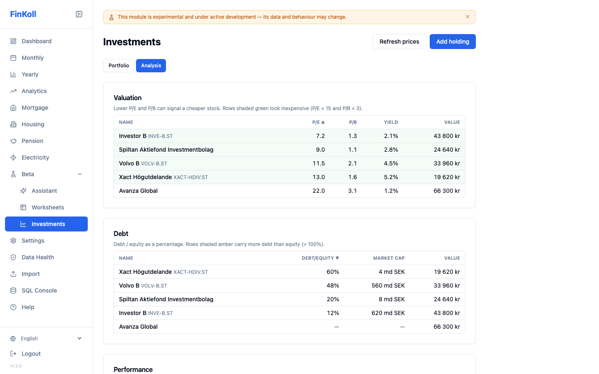

---

## Pension

The net-worth hub. Keep your pension capital in one place — typically pasted from
**minpension.se**. Holdings are grouped into the three Swedish buckets (**allmän**,
**tjänste­pension**, **privat**) with per-bucket and grand totals, an optional
**projected monthly payout**, a **value-over-time** chart, and a **paste importer** (one
holding per line). Every time you update a value a snapshot is recorded, and a **monthly
movement** table shows the month-over-month change (kr and %) with the current total.
The page computes **net worth = investments + pension capital + home equity**: give each
property a **market value** and **your ownership share** (e.g. 50% for a co-owned home)
and assign each mortgage to the property it's secured on, so your equity = **(market
value − that property's loan) × your share**. Pension is **capital / net worth**, not
monthly cash flow, so it stays out of the budget's net result (and lives here rather
than in the Yearly overview). *(Coming later: withdrawal/takeout planning.)*

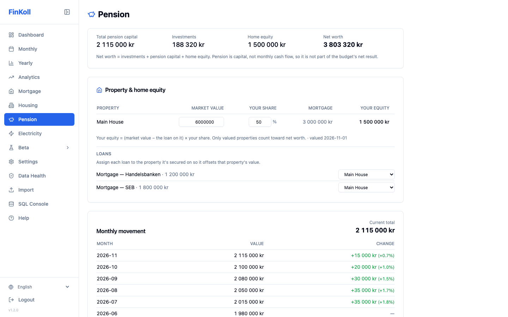

---

## Import

Bring in transactions from a spreadsheet, with category mapping that FinKoll
remembers for next time.

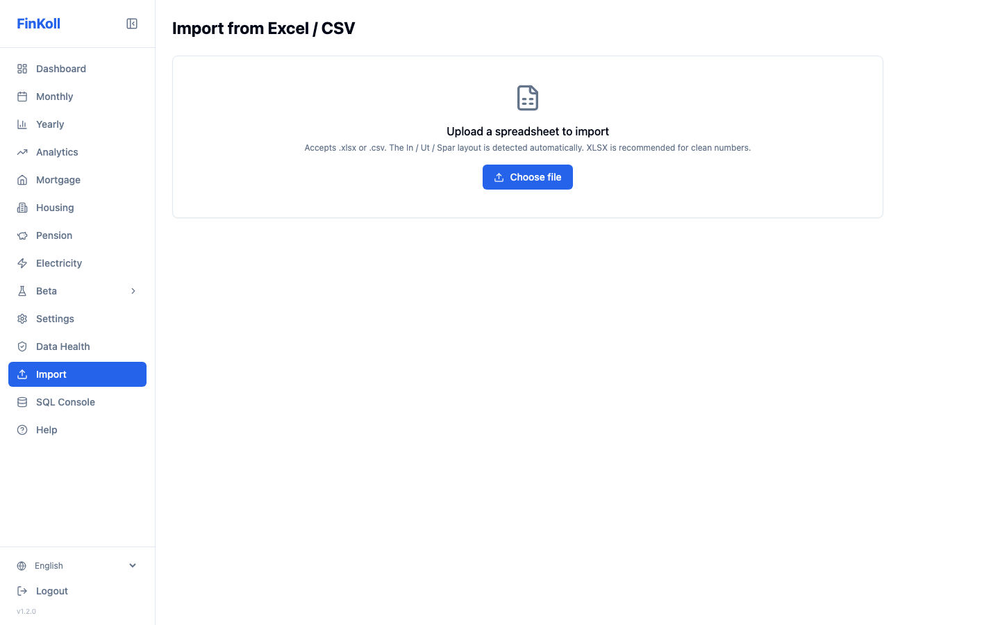

---

## SQL Console

A read-only-friendly SQL console for power users to query their own encrypted
database directly.

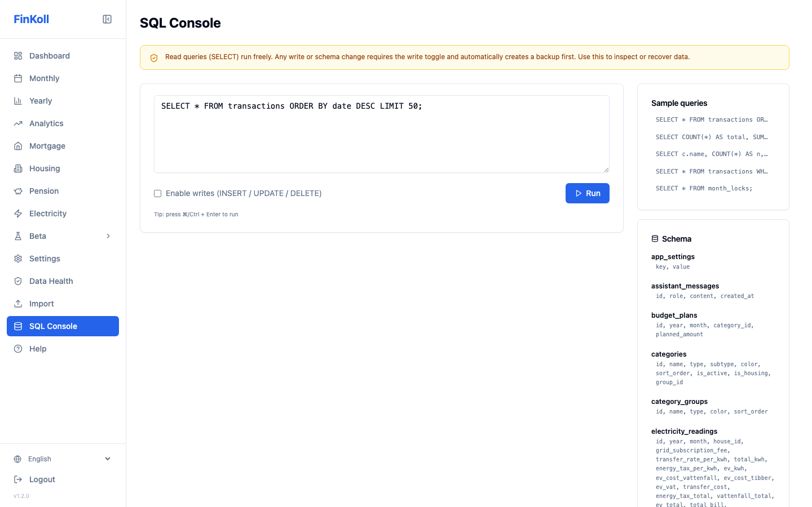

---

## Settings

Categories (rename, recolor, reorder), the net-result target, backups, language,
appearance, and changing your password — all in one place.

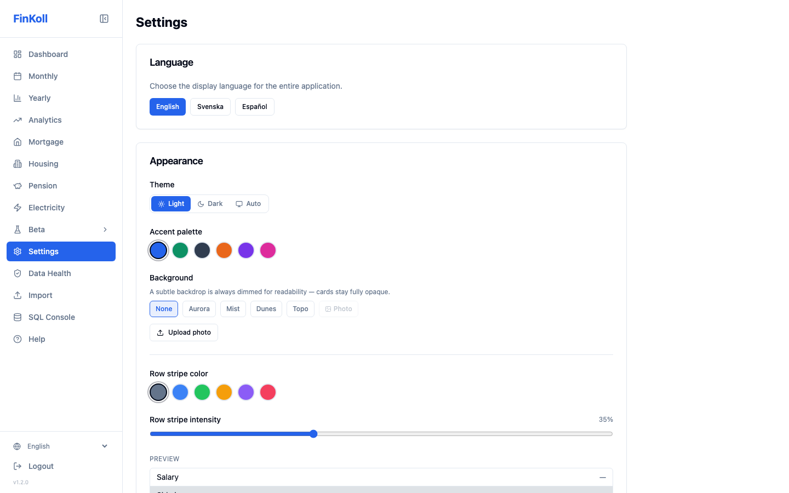

---

## Help

A built-in, illustrated help section with a quickstart for the budget/monthly
template workflow, available in English, Swedish, and Spanish.

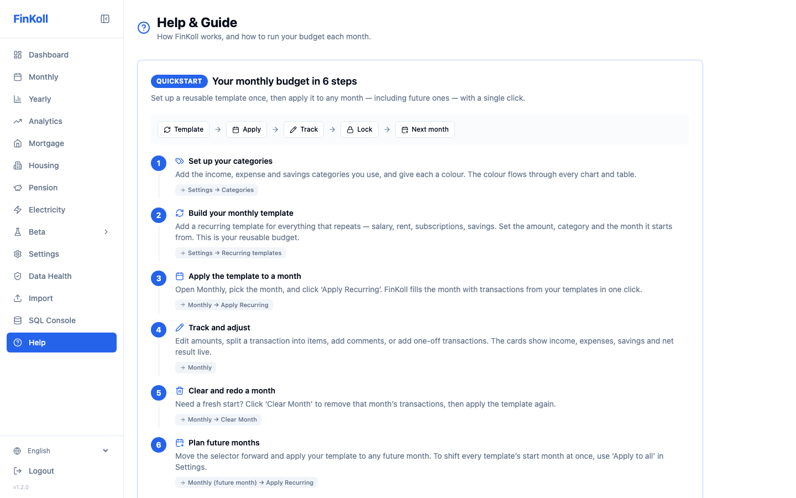
