# FinKoll — Visuell genomgång

🌐 [English](runthrough.md) · **Svenska** · [Español](runthrough.es.md)

En guidad rundtur genom alla vyer i FinKoll, tagen från en demo-instans fylld med
ett helt år av realistiska hushållsdata. Alla siffror är påhittade.

> *Skärmbilderna är på engelska tills vidare.*

> Vill du testa själv? Se [Kom igång-guiden](../GETTING-STARTED.sv.md)
> ([English](../GETTING-STARTED.md) · [Español](../GETTING-STARTED.es.md)).

---

## Översikt (Dashboard)

Din månad i ett ögonkast: inkomster, utgifter, sparande, **nettoresultat** och
sparkvot högst upp, en **Smart Insights**-panel (hälsopoäng, budgetvarningar och
trendobservationer), tabeller för budget mot utfall, samt en utgiftsfördelning.

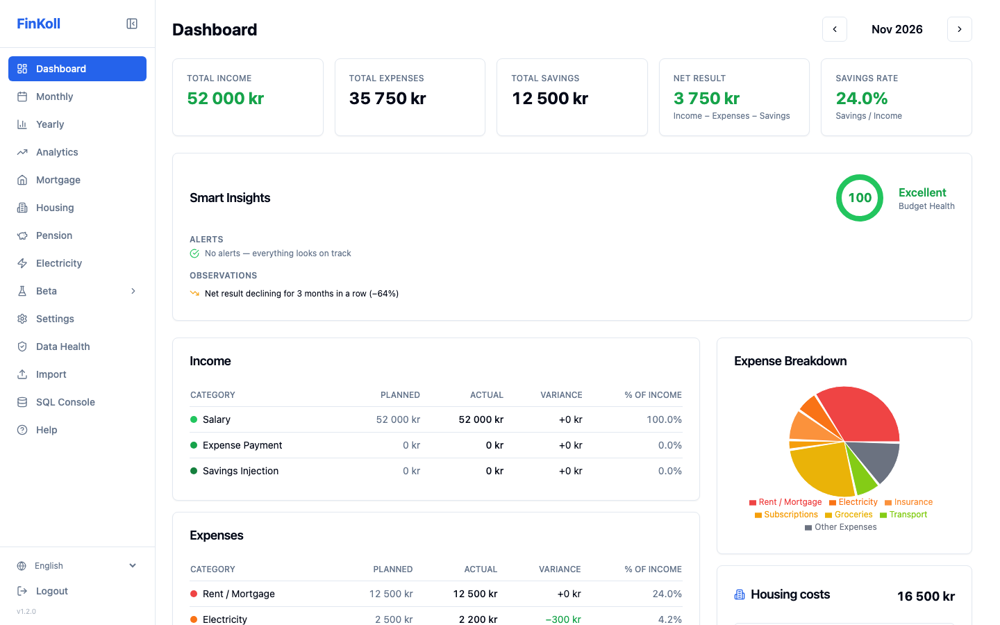

---

## Assistent

En chatt för att **fråga om och lägga till data** på vanligt språk — en ekonomisk
copilot som kan dina siffror. Ställ öppna frågor ("vad är vår nettoförmögenhet?",
"genomsnittlig elförbrukning per månad?", "hur mycket lägger vi på mat per månad?")
eller lägg till poster ("lägg till huvudhusets bolån denna månad, 2 500 kr"). Modellen
bara **dirigerar**: varje siffra räknas ut av FinKoll (aldrig påhittad), det de
inbyggda verktygen inte täcker körs som **skrivskyddad SQL** mot din egen databas, och
varje ändring är ett **utkast du bekräftar** innan det sparas — inget skrivs åt dig.
**AI-motorn är utbytbar** och **av som standard**: peka den mot en molnnyckel (Claude)
eller en lokal modell (Ollama på en liten box du lägger till, så Pi:n förblir obelastad),
ställs in i Inställningar.

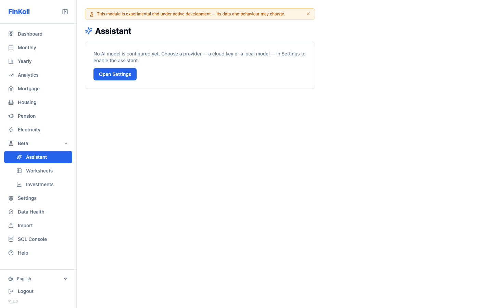

---

## Månad

Arbetsvyn för en enskild månad — planerat mot utfall per kategori med avvikelse,
redigering direkt i vyn, tillämpning av återkommande mallar och upptäckt av
dubbletter.

---

## År

Hela året i en matris: varje transaktionsrad grupperad under sin kategori,
månaderna längs överkanten, med innevarande månad markerad och resultat flaggade
mot dina mål.

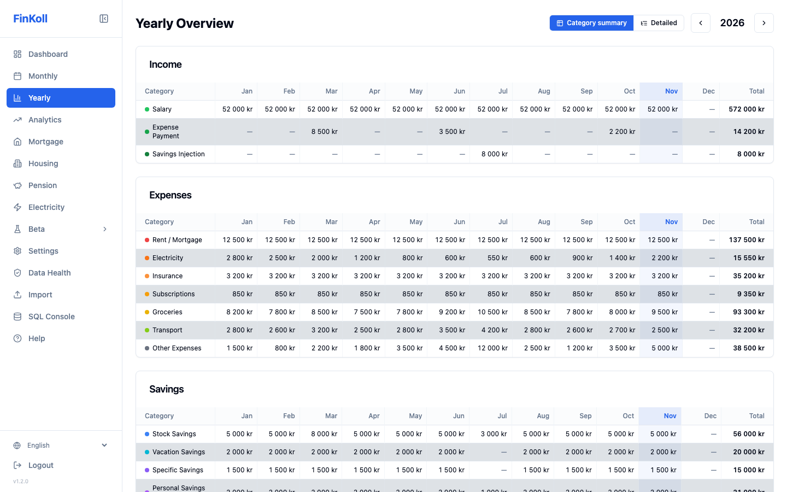

---

## Analys

Utfall plus en prognos för resten av året, en nettoresultattrend, en
sparandefördelning och ett särskilt **el-avsnitt** (kostnad per källa och
månadsförbrukning).

---

## El

En Tibber-centrerad, automatiskt beräknande elspårning — per hus, per månad. Ange
Tibber-totalen och kWh; FinKoll beräknar Vattenfalls nätdel (överföring,
energiskatt, fast avgift, moms) och elbilsladdningens andel. Stöder flera hus med
delade eller husvisa priser.

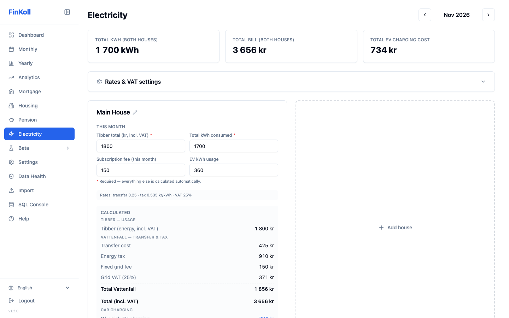

---

## Kalkylblad (Worksheets)

Egna kalkylblad med riktiga formler (drivs av HyperFormula) för enstaka
beräkningar — renoveringar, resor, bolånescenarier. En **FinKoll-data**-panel
visar dina aktuella budgetsummor som namngivna värden du kan referera till.

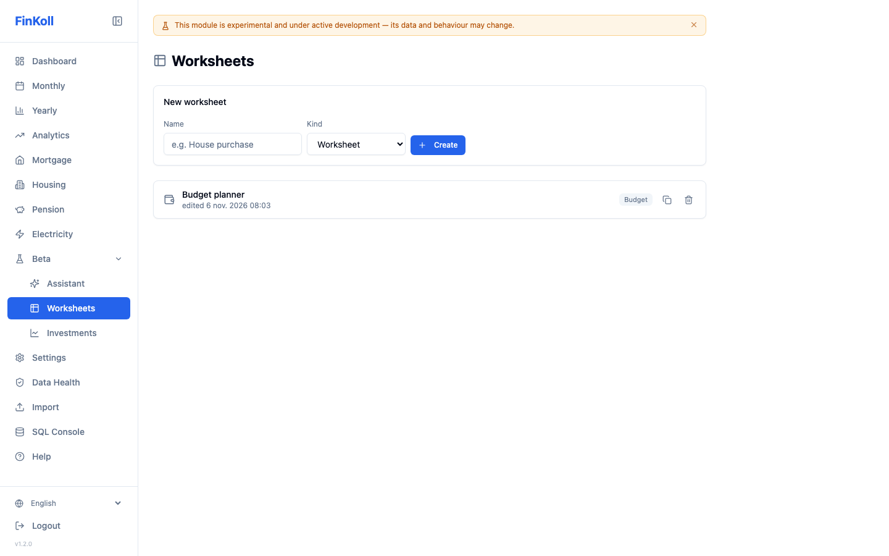

---

## Bolån

Håll koll på bolån med en **fast månadsamortering** plus ränta (totalt = ränta +
amortering). **Gruppera lån per hus/objekt** — tryck på **Gruppera lån**, markera
dem som ska slås ihop, namnge gruppen och bekräfta — för att se den totala skulden,
den sammanvägda räntan (med spridningen markerad när räntorna skiljer sig) och
total månadskostnad. **Prognosen görs på gruppnivå**: öppna gruppens **Prognos**
för att se en **projektion** av gruppens totala månadskostnad och kvarvarande skuld
om **1, 5 och 10 år** (hur mycket du har amorterat). Planera framtida
ränte-/amorteringsändringar som **en prognos för hela gruppen** (standard), eller
byt till **per lån** när de skiljer sig — oavsett vilket sparas den. Fristående
(ogrupperade) lån har sin egen prognos på kortet. Perfekt för att planera framåt
eller förhandla med banken.

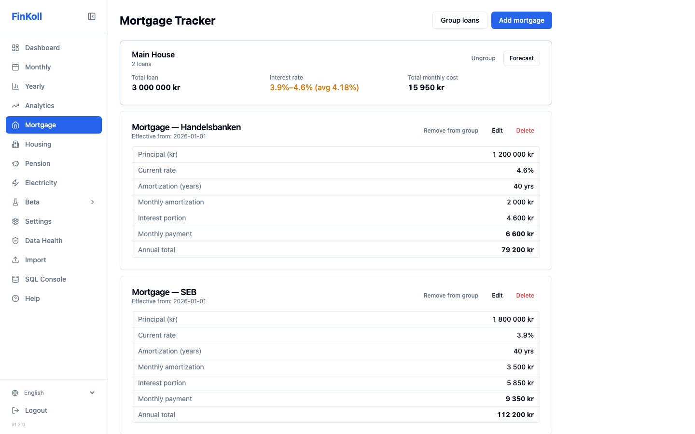

---

## Boendekostnader

Se den löpande kostnaden för ditt **primärboende** för sig — separerat från allt
annat. Varje transaktion kan kopplas till ett **hus/objekt** (samma hus som
el-modulen), och boendekostnaderna är **primärboendets** transaktioner (väljs
här). Du behåller en delad kategori per kostnadstyp: boende-kategorier (Hyra/Bolån,
El, Försäkring) sätter nya transaktioner till primärhuset som standard, och du
flyttar landställets till rätt hus per transaktion. En räkning som täcker båda husen
(t.ex. en elräkning) kan **delas upp**, där varje rad kopplas till sitt eget hus —
då räknas bara primärboendets rad in och landställets rad lämnas utanför, samtidigt
som transaktionen förblir en post. Återkommande mallar kan också ha ett hus
(primär, landet eller allmänt), så genererade kostnader hamnar på rätt objekt
automatiskt. Boendekostnaderna visas på
månadsvyn (en nyckeltalsruta + uppdelning av vad som ingår), i årsvyn (en
boendetabell och en delsummerad rad i den detaljerade matrisen), och på den här
egna sidan med en matris kategori × månad.

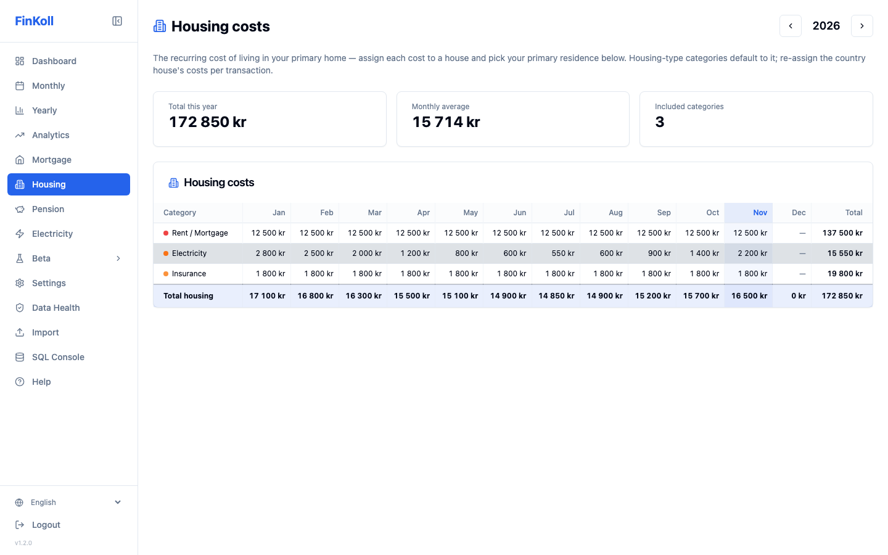

---

## Investeringar

Följ en portfölj av aktier och fonder med vinst/förlust nära realtid. Lägg till
innehav med **symbolsökning**; FinKoll hämtar kurser och valuta och räknar om allt
till **SEK**, och visar vinst/förlust per innehav och totalt, dagens förändring och
en **utvecklingsgraf över tid**. Marknadsdata kommer från en **utbytbar källa** —
gratis **Yahoo Finance** som standard (fördröjd / dagsslut), eller ett **manuellt**
läge där du själv anger priser och inget hämtas. Källan kan bytas i inställningarna,
så en betald/officiell feed (eller en mäklarimport) kan läggas till senare.

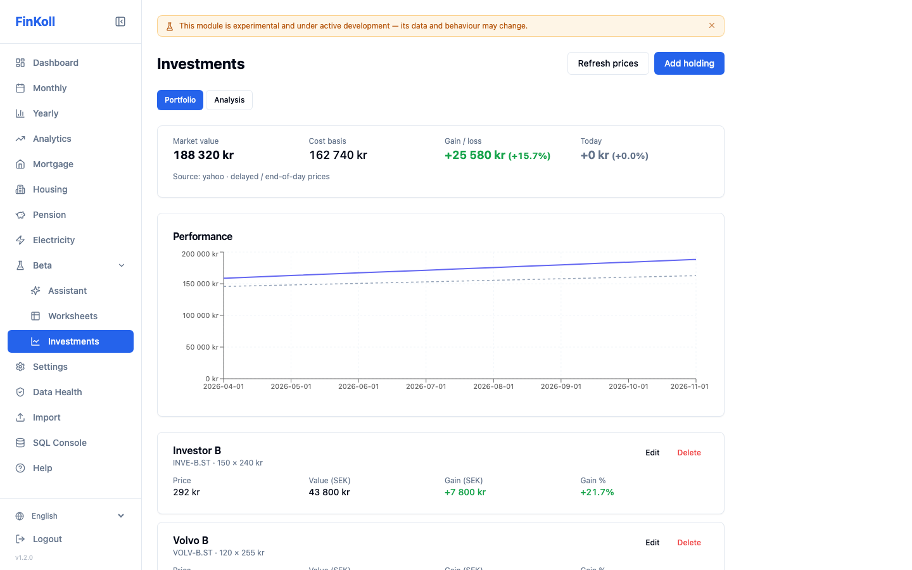

En **Analys**-flik gör samma data till tre sorterbara vyer: **Värdering** (P/E,
P/B, direktavkastning — billiga rader markeras), **Skuldsättning** (skuld/eget
kapital, börsvärde) och **Utveckling** (avkastning 1 mån, 3 mån, 1 år samt total
vinst).

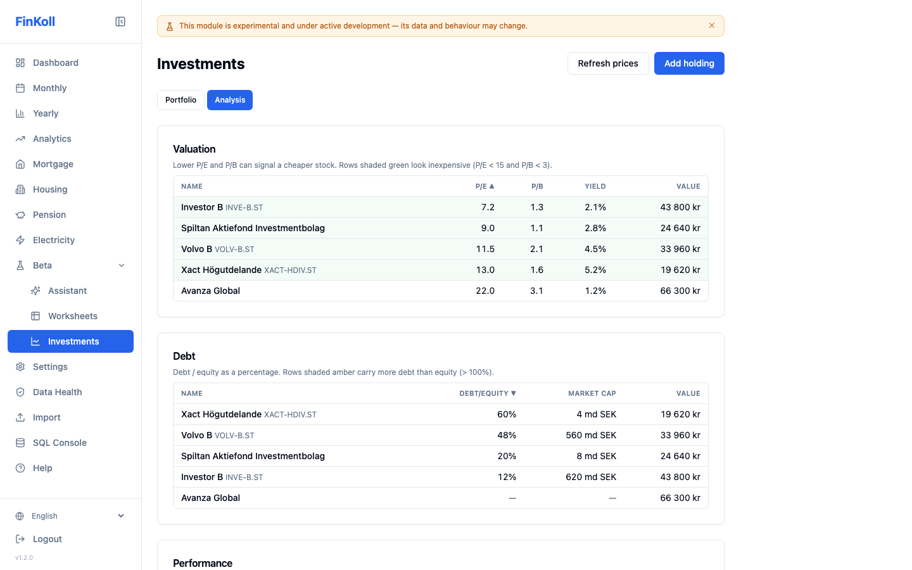

---

## Pension

Navet för nettoförmögenhet. Samla ditt pensionskapital på ett ställe — oftast inklistrat
från **minpension.se**. Innehaven grupperas i de tre svenska kategorierna (**allmän**,
**tjänstepension**, **privat**) med del- och totalsummor, en valfri **prognostiserad
månadsutbetalning**, ett diagram över **värde över tid** och en **inklistringsimport**
(ett innehav per rad). Varje gång du uppdaterar ett värde sparas en ögonblicksbild, och
en tabell för **månadsförändring** visar förändringen månad för månad (kr och %) med
aktuellt totalt. Sidan räknar ut **nettoförmögenhet = investeringar + pensionskapital +
bostadskapital**: ge varje bostad ett **marknadsvärde** och **din andel** (t.ex. 50 %
för en delägd bostad) och koppla varje bolån till bostaden det är säkrat mot, så blir
ditt kapital = **(marknadsvärde − bostadens lån) × din andel**. Pension är **kapital /
förmögenhet**, inte månatligt kassaflöde, så det ligger utanför budgetens nettoresultat
(och visas här i stället för i årsvyn). *(Kommer senare: uttagsplanering.)*

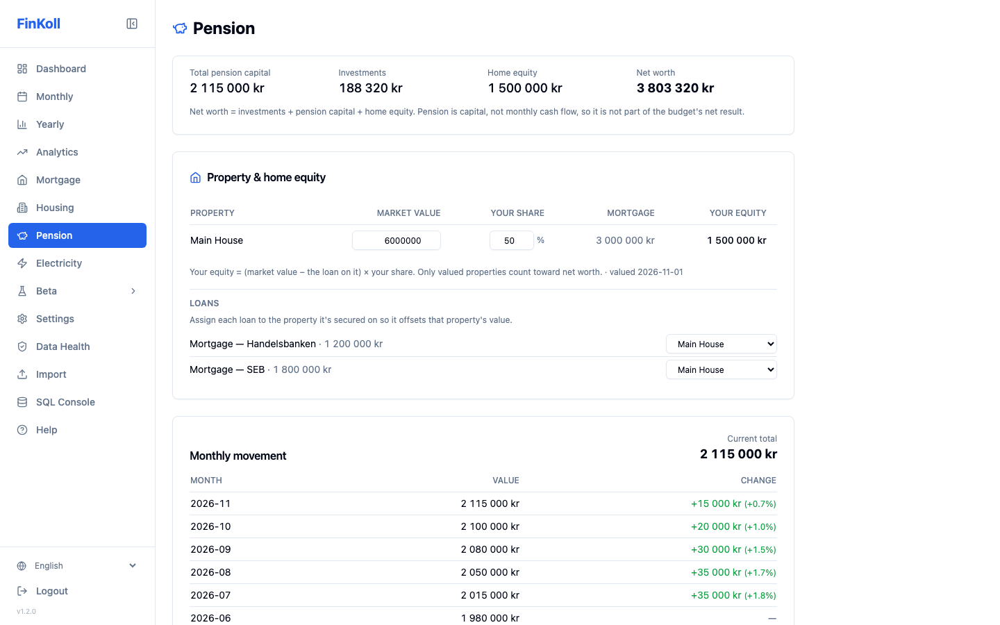

---

## Import

Importera transaktioner från ett kalkylblad, med kategorimappning som FinKoll
kommer ihåg till nästa gång.

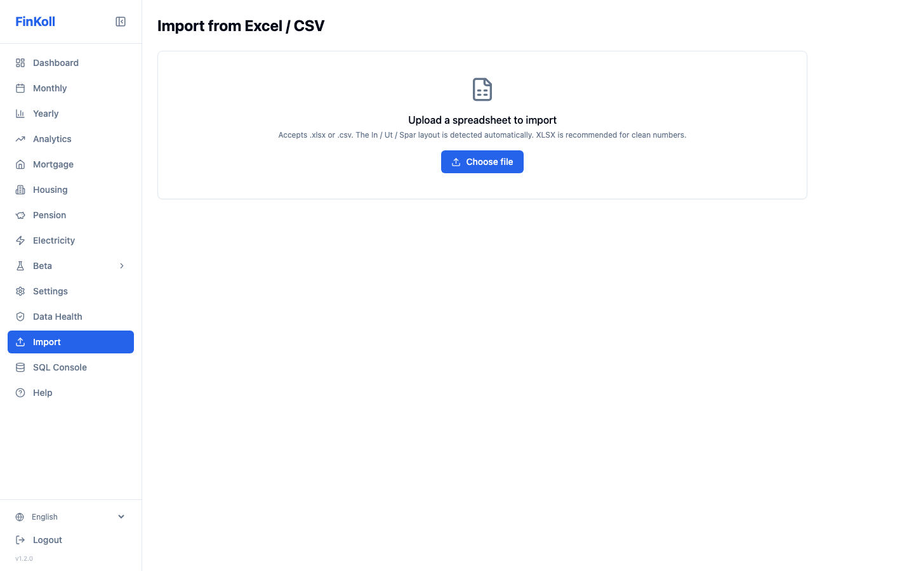

---

## SQL-konsol

En SQL-konsol för avancerade användare som vill fråga sin egen krypterade databas
direkt.

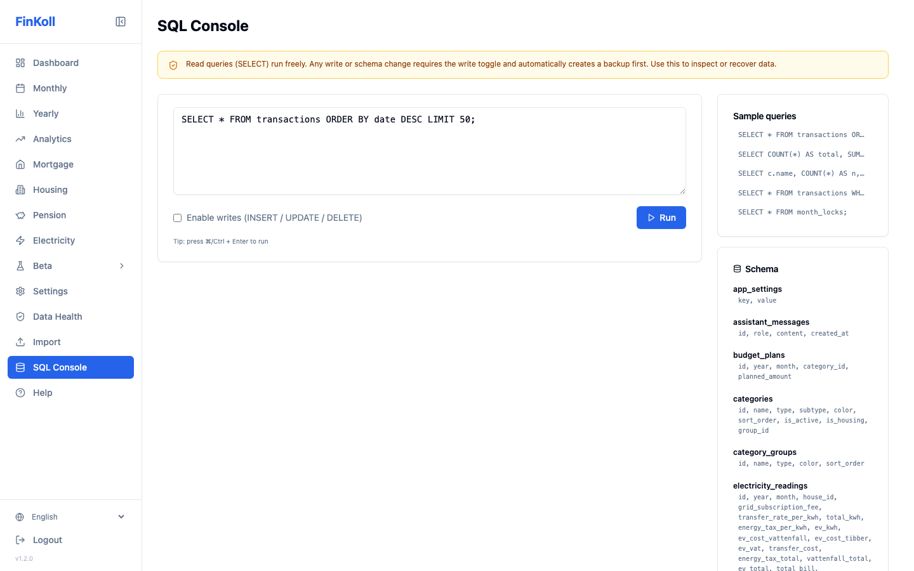

---

## Inställningar

Kategorier (byt namn, färg och ordning), nettoresultatmål, säkerhetskopior,
språk, utseende och byte av lösenord — allt på ett ställe.

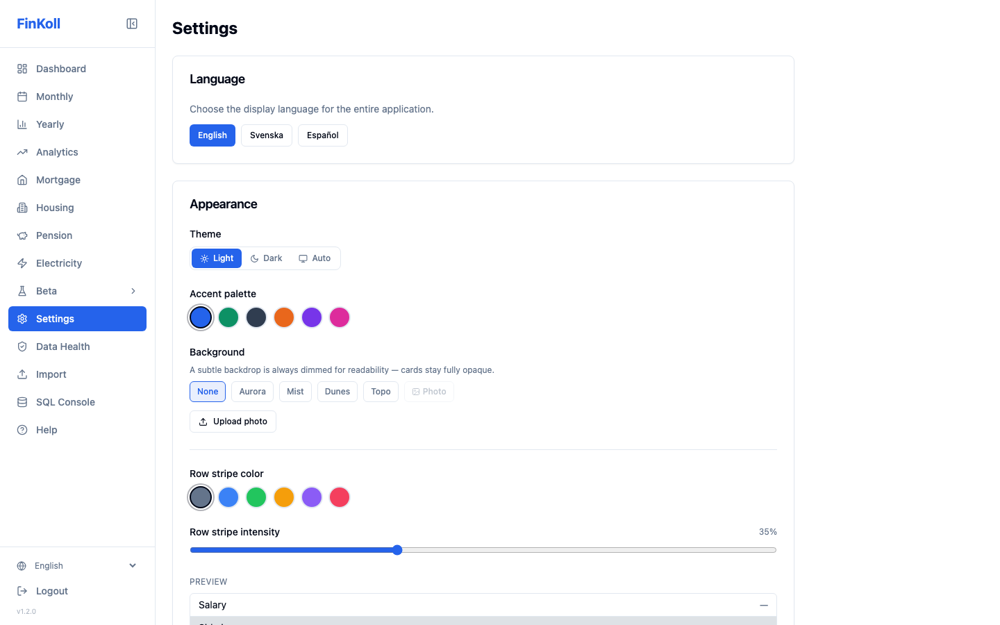

---

## Hjälp

Ett inbyggt, illustrerat hjälpavsnitt med en snabbstart för budget-/
månadsmallflödet, tillgängligt på engelska, svenska och spanska.

