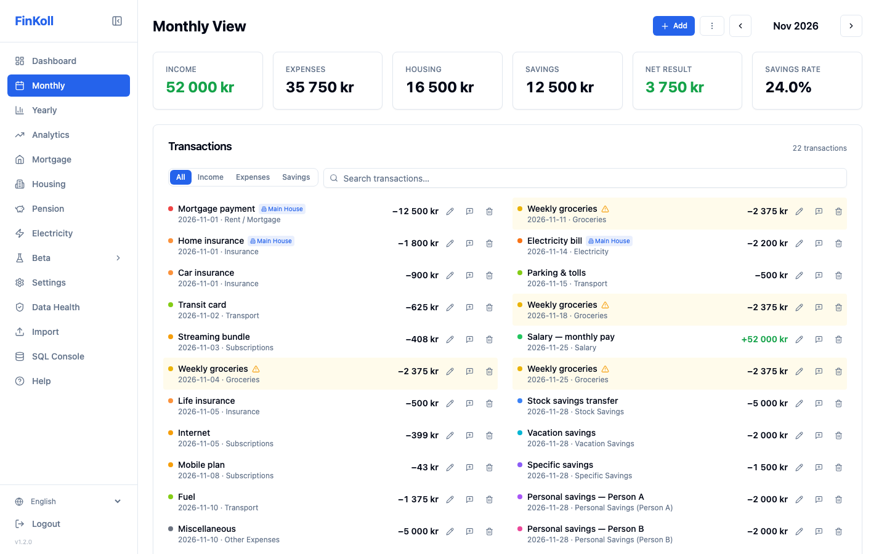
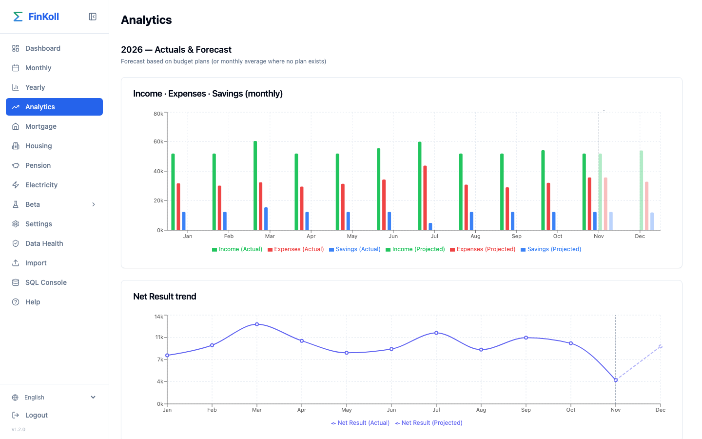
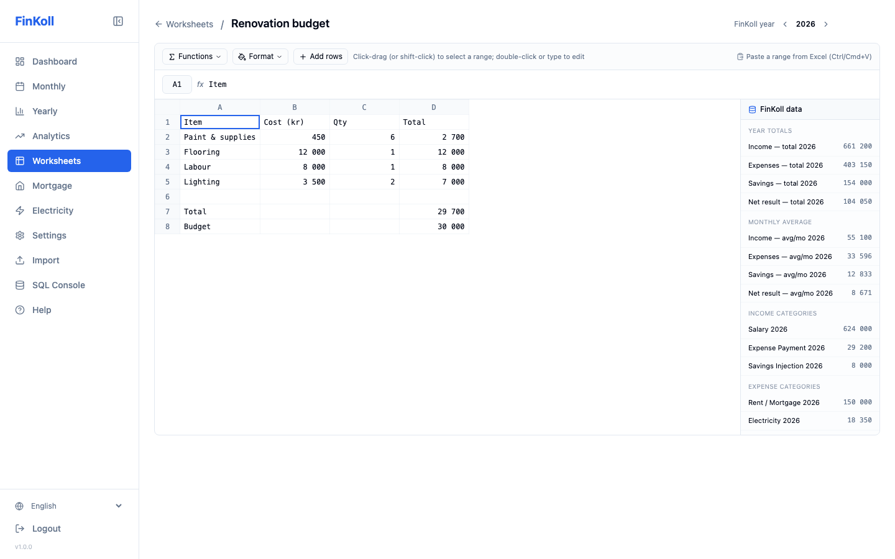
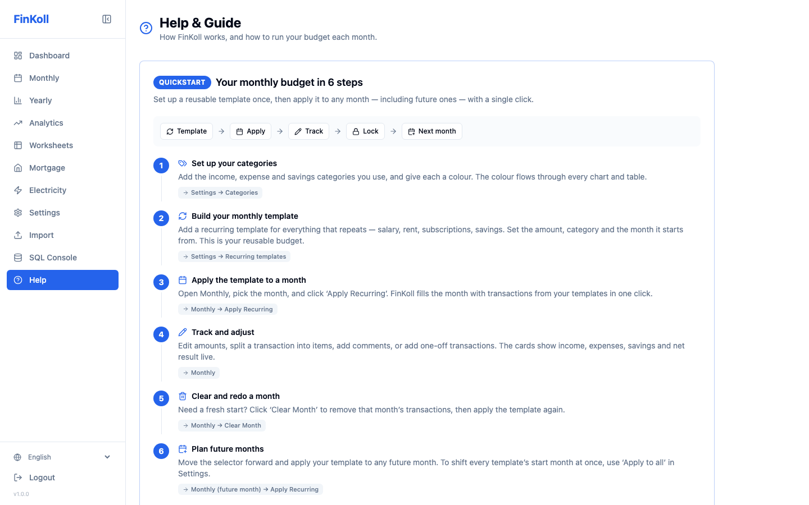

# FinKoll — Visuell genomgång

🌐 [English](runthrough.md) · **Svenska** · [Español](runthrough.es.md)

En guidad rundtur genom alla vyer i FinKoll, tagen från en demo-instans fylld med
ett helt år av realistiska hushållsdata. Alla siffror är påhittade.

> *Skärmbilderna är på engelska tills vidare.*

> Vill du testa själv? Se [Kom igång-guiden](../GETTING-STARTED.sv.md)
> ([English](../GETTING-STARTED.md) · [Español](../GETTING-STARTED.es.md)).

---

## Översikt (Dashboard)

Din månad i ett ögonkast: inkomster, utgifter, sparande, **nettoresultat** och
sparkvot högst upp, en **Smart Insights**-panel (hälsopoäng, budgetvarningar och
trendobservationer), tabeller för budget mot utfall, samt en utgiftsfördelning.

---

## Månad

Arbetsvyn för en enskild månad — planerat mot utfall per kategori med avvikelse,
redigering direkt i vyn, tillämpning av återkommande mallar och upptäckt av
dubbletter.

---

## År

Hela året i en matris: varje transaktionsrad grupperad under sin kategori,
månaderna längs överkanten, med innevarande månad markerad och resultat flaggade
mot dina mål.

---

## Analys

Utfall plus en prognos för resten av året, en nettoresultattrend, en
sparandefördelning och ett särskilt **el-avsnitt** (kostnad per källa och
månadsförbrukning).

---

## El

En Tibber-centrerad, automatiskt beräknande elspårning — per hus, per månad. Ange
Tibber-totalen och kWh; FinKoll beräknar Vattenfalls nätdel (överföring,
energiskatt, fast avgift, moms) och elbilsladdningens andel. Stöder flera hus med
delade eller husvisa priser.

---

## Kalkylblad (Worksheets)

Egna kalkylblad med riktiga formler (drivs av HyperFormula) för enstaka
beräkningar — renoveringar, resor, bolånescenarier. En **FinKoll-data**-panel
visar dina aktuella budgetsummor som namngivna värden du kan referera till.

---

## Bolån

Håll koll på bolån med kapital, ränta, amorteringstid och beräknade
månadsbetalningar.

---

## Import

Importera transaktioner från ett kalkylblad, med kategorimappning som FinKoll
kommer ihåg till nästa gång.

---

## SQL-konsol

En SQL-konsol för avancerade användare som vill fråga sin egen krypterade databas
direkt.

---

## Inställningar

Kategorier (byt namn, färg och ordning), nettoresultatmål, säkerhetskopior,
språk, utseende och byte av lösenord — allt på ett ställe.

---

## Hjälp

Ett inbyggt, illustrerat hjälpavsnitt med en snabbstart för budget-/
månadsmallflödet, tillgängligt på engelska, svenska och spanska.

